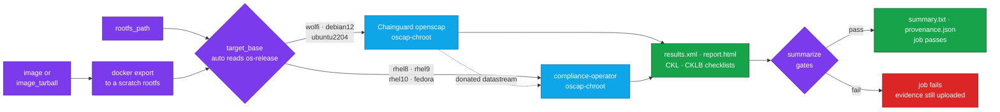

<div align="center">


# STIG Scanner for CircleCI and GitHub Actions

### Scan container images against DISA STIGs in CI, and keep the evidence for your ATO.

Run [OpenSCAP](https://www.open-scap.org/) against RHEL, Ubuntu, Debian, Fedora and Wolfi images, or extracted filesystems, with one CircleCI job or a few GitHub Actions steps,<br>
and get an HTML report, XCCDF results, STIG Viewer checklists and a provenance record back as artifacts.<br>
Scanner images pinned by digest · Scan containers run with `--network none` · No `sudo`

[](https://circleci.com/gh/juburr/stig-scanner-orb)
[](https://github.com/juburr/stig-scanner-orb/actions/workflows/actions.yml)
[](https://circleci.com/developer/orbs/orb/juburr/stig-scanner-orb)
[](LICENSE)
[](https://discuss.circleci.com/c/ecosystem/orbs)


**[Quick Start](#-quick-start)** · **[Features](#-why-stig-scanner-orb)** · **[Targets](#-supported-targets)** · **[Gates](#-gates)** · **[Checklists](#-stig-viewer-checklists)** · **[Job Parameters](#stig-scanner-orbscan)** · **[CircleCI Commands](#-circleci-commands)** · **[GitHub Actions](#-github-actions)** · **[Security](#-secure-by-design)**

<sub>An unofficial, community-maintained orb, not endorsed by or affiliated with DISA, the Department of Defense, Red Hat or Canonical. [Contributions are welcome!](#-contributing)</sub>

</div>

<br>

## ✨ Why stig-scanner-orb?

<table>
<tr>
<td width="33%" valign="top">
🎯 <b>Seven target families, one job</b><br><br>
RHEL 8, 9 and 10, Ubuntu 22.04, Debian 12, Fedora and Wolfi. <code>target_base: auto</code> reads the image's <code>/etc/os-release</code>, so Rocky, Alma, Oracle Linux and Google distroless images work too. <a href="#-supported-targets">Supported targets</a>
</td>
<td width="33%" valign="top">
🧭 <b>The right scanner for every target</b><br><br>
Chainguard's OpenSCAP build has no RPM probes, and the scanner that has them ships no SCAP content. The orb sends each target to the scanner that can evaluate it and supplies the datastream it needs. <a href="#-how-it-works">How it works</a>
</td>
<td width="33%" valign="top">
📋 <b>STIG Viewer checklists, generated offline</b><br><br>
<code>.ckl</code> and <code>.cklb</code> files with official DISA text, CCIs and every row for RHEL 8, 9 and 10 and Ubuntu 22.04, plus a GPOS SRG checklist for Wolfi. No DISA download needed. <a href="#-stig-viewer-checklists">Checklists</a>
</td>
</tr>
<tr>
<td width="33%" valign="top">
🚦 <b>Gates that don't pass hollow scans</b><br><br>
A scan in which nothing evaluated, or that returned errors, fails by default instead of looking clean. Add a severity threshold with <code>fail_on</code> and waive triaged findings with <code>ignore_findings</code>. <a href="#-gates">Gates</a>
</td>
<td width="33%" valign="top">
🔁 <b>Evidence an assessor can trace</b><br><br>
Scanner images are pinned by digest, and every scan records the image digests, the datastream's sha256 and the OpenSCAP version in <code>provenance.json</code>. <a href="#-reproducibility-and-provenance">Provenance</a>
</td>
<td width="33%" valign="top">
🔒 <b>No network inside the scan</b><br><br>
Every helper and scanner container runs with <code>--network none</code>, and none gets the Docker socket, <code>--privileged</code> or <code>--pid=host</code>. The only traffic is the daemon's image pulls, which mirrors can replace. <a href="#-network-access">Network access</a>
</td>
</tr>
</table>

### 🧩 The Orb vs. a Hand-Rolled Script

| | Scripting OpenSCAP yourself | With the orb |
| --- | --- | --- |
| Picking a scanner | Chainguard's `oscap` is built without `librpm`, so rpm-state rules on a RHEL target silently come back `notapplicable` | RHEL and Fedora targets run in the compliance-operator scanner, with the datastream donated from the Chainguard image |
| Reading the image | `oscap-docker` needs `--pid=host` or the Docker socket mounted into the scanner | The image is exported to a scratch rootfs and scanned read-only with `oscap-chroot`, in containers with `--network none` |
| Hollow scans | An all-`notapplicable` result looks like a clean pass | `require_evaluated_rules` fails it by default |
| Distroless images | OpenSCAP's dpkg probe can't read `status.d/`, so package rules come back `error` | `/var/lib/dpkg/status` is built from the stanzas in the orb's scratch copy |
| Evidence | Which scanner build and content produced this result? | Digest-pinned images, and `provenance.json` records the digests, the datastream's sha256 and the OpenSCAP version |
| Checklists | Copy results into STIG Viewer by hand | `.ckl` and `.cklb` with official DISA text, generated offline |

## 🔄 How It Works



This orb uses the same process Chainguard outlines in its [STIGs for Chainguard Containers](https://edu.chainguard.dev/chainguard/chainguard-images/features/image-stigs/) guide, extended to other, non-Wolfi operating systems such as UBI 8, UBI 9, UBI 10, Ubuntu, Debian, Fedora and certain distroless images. The `scan` job exports your image to a scratch rootfs (or takes the tree you pass as `rootfs_path`), resolves `target_base` to a scanner, datastream and profile, and runs `oscap-chroot` against the tree. Wolfi, Debian and Ubuntu targets run in Chainguard's openscap image, which bundles every major datastream. RHEL and Fedora targets run in the compliance-operator scanner, which has the RPM probes Chainguard's build lacks but no SCAP content, so the orb donates the datastream from the Chainguard image. Both scanners are pinned by digest. The job then turns `results.xml` into STIG Viewer checklists, and `summarize` writes `summary.txt` and `provenance.json` and applies the [gates](#-gates).

### What Each Step Does

1. (Optional) `docker load` an image tarball produced by an upstream job.
2. Host-extract the target image's rootfs via `docker create` + `docker export`. Skipped when you pass `rootfs_path` directly.
3. Resolve `target_base` to a scanner image, datastream, and XCCDF profile. `auto` reads `/etc/os-release` from the extracted rootfs.
4. For Google distroless images, build `/var/lib/dpkg/status` in the scratch rootfs from the per-package stanzas (see [Distroless Images](#distroless-images)).
5. Pull the resolved scanner image (pinned by digest). For RPM-based targets, copy the right `ssg-*-ds.xml` out of the Chainguard openscap image (which bundles every major datastream) into a private per-scan snapshot directory. The compliance-operator scanner is purpose-built for `oscap-chroot` and ships no SCAP content of its own, so the orb donates the file from Chainguard.
6. Run `oscap-chroot` against the extracted rootfs.
7. Generate STIG Viewer checklists from `results.xml` for supported STIG profiles.
8. Parse `results.xml`, write `summary.txt` and `provenance.json`, apply the ignore-list, and decide the gates.
9. Upload the evidence with `store_artifacts`, so it is always retrievable, even on a failing gate, and then enforce the gates. Checklists upload only after an artifact guard has validated them.

`oscap-chroot` is preferred over `oscap-docker` because it doesn't require `--pid=host` or bind-mounting the docker socket into the scanner — the scanner reads a static rootfs the runner already extracted. That keeps the scan container as unprivileged as the rest of the pipeline.

## 🚀 Quick Start

On CircleCI, add the orb and point the `scan` job at an image. Copy this into `.circleci/config.yml`:

```yaml
version: 2.1
orbs:
  stig-scanner-orb: juburr/stig-scanner-orb@2.1.0

workflows:
  scan:
    jobs:
      - stig-scanner-orb/scan:
          image: cgr.dev/chainguard/static:latest
          target_base: wolfi
```

That's enough to produce `report.html`, `results.xml`, `summary.txt` and `provenance.json`, plus STIG Viewer checklists for supported profiles, under `stig/` in the job's **Artifacts** tab. Swap in your own image: any tag the runner can pull, or one an earlier job built (see [Recipes](#-recipes)). Leave out `target_base` to have the orb detect the OS from the image's `/etc/os-release`.

On GitHub Actions, run the orb's [actions](#-github-actions) in a job on an Ubuntu runner, which has the Docker daemon the scan needs, and upload the evidence with `actions/upload-artifact`. Copy this into `.github/workflows/stig.yml`:

```yaml
name: STIG scan
on: [push]

jobs:
  stig:
    runs-on: ubuntu-24.04
    steps:
      - uses: juburr/stig-scanner-orb/actions/scan@v2.1.0
        with:
          image: cgr.dev/chainguard/static:latest
          target_base: wolfi
      - uses: juburr/stig-scanner-orb/actions/generate_checklist@v2.1.0
      - uses: juburr/stig-scanner-orb/actions/summarize@v2.1.0
        with:
          checklist: auto
      # The evidence uploads even when a gate fails.
      - name: Upload the scan evidence
        if: always()
        uses: actions/upload-artifact@cf430e030ddbb5b0abf93d22962f4752f3646cd9 # v7.0.2
        with:
          name: stig-evidence
          path: |
            build/stig/report.html
            build/stig/results.xml
            build/stig/summary.txt
            build/stig/provenance.json
            build/stig/scan-plan.env
            build/stig/tailoring-meta.json
            build/stig/checklist-meta.json
          if-no-files-found: ignore
      # The checklists upload only when every step passed.
      - name: Upload the checklists
        uses: actions/upload-artifact@cf430e030ddbb5b0abf93d22962f4752f3646cd9 # v7.0.2
        with:
          name: stig-checklists
          path: |
            build/stig/checklist.ckl
            build/stig/checklist.cklb
          if-no-files-found: ignore
```

The same files land in the run's **Artifacts**. [GitHub Actions](#-github-actions) covers what the CircleCI job does that a workflow does itself.

> [!NOTE]
> `fail_on` is `never` by default, so evaluated `fail` results are reported without failing the build and you can triage a baseline before turning that gate on. Two gates are on by default, because neither result is a compliance answer: a scan with any `error` or `unknown` result, or no readable package inventory, fails the job (`fail_on_scan_error: true`), and so does a scan in which **zero rules evaluate** to pass or fail (`require_evaluated_rules: true`). An all-`notapplicable` result is what you get from a mis-dispatched scan (wrong `target_base`, or a scanner without the probes the datastream needs), and before 2.0.0 that was a green build. See [Gates](#-gates).

> [!TIP]
> Upgrading? From 2.0.0, `fail_on` counts only `fail` results, and `error` and `unknown` results fail the job by default through the new `fail_on_scan_error`. From 1.x, `fail_on_finding` is now `fail_on`, hollow scans fail, and `debian12` scans use a different default profile. See [Upgrading](#-upgrading).

## 🎯 Supported Targets

| `target_base` | Scanner image | Datastream | Default profile |
| --- | --- | --- | --- |
| `wolfi` | Chainguard openscap | `ssg-chainguard-gpos-ds.xml` | Chainguard GPOS |
| `debian12` | Chainguard openscap | `ssg-debian12-ds.xml` | CIS Level 1 Server ([why](#debian-12-profiles)) |
| `ubuntu2204` | Chainguard openscap | `ssg-ubuntu2204-ds.xml` | DISA STIG |
| `rhel8` | compliance-operator openscap-ocp | `ssg-rhel8-ds.xml` | DISA STIG |
| `rhel9` | compliance-operator openscap-ocp | `ssg-rhel9-ds.xml` | DISA STIG |
| `rhel10` | compliance-operator openscap-ocp | `ssg-rhel10-ds.xml` | DISA STIG |
| `fedora` | compliance-operator openscap-ocp | `ssg-fedora-ds.xml` | standard |
| `auto` *(default)* | resolved from `/etc/os-release` | resolved | resolved |

Both scanner images are pinned by digest; see [Pinned Images](#pinned-images) for the exact references. The Chainguard image also serves as the donor for RPM datastreams and as the root-privileged extraction helper.

`auto` recognizes RHEL, Rocky, Alma, Oracle Linux, Fedora, Debian 12, Ubuntu 22.04, Wolfi, and Chainguard via the target's `/etc/os-release`, with filesystem-shape fallbacks (`apk`, `rpm`, `dpkg` including the distroless `status.d/` layout) for images that lack one. An `/etc/os-release` that names an unsupported OS or version fails the scan instead of falling back. For `scratch` images that ship neither `/etc/os-release` nor a package database, set `target_base` explicitly.

Tested in CI against `ubi10/ubi`, `ubi9/ubi`, `ubi9/ubi-minimal`, `ubi8/ubi`, `ubi8/ubi-minimal`, `gcr.io/distroless/cc-debian12`, `debian:12-slim`, `ubuntu:22.04`, `fedora`, and `cgr.dev/chainguard/static`.

### Debian 12 Profiles

There is no DISA STIG for Debian. `ssg-debian12-ds.xml` (SSG 0.1.82 in the pinned image) ships 13 profiles, and since 2.0.0 the `debian12` default is **CIS Level 1 Server**. Rule results measured with the pinned content (distroless with its dpkg status synthesized, see below):

| Profile (`xccdf_org.ssgproject.content_profile_…`) | Title | Selected rules | `debian:12-slim` pass / fail (evaluated) | `distroless/cc-debian12` pass / fail (evaluated) |
| --- | --- | --- | --- | --- |
| `anssi_bp28_enhanced` | ANSSI-BP-028 v2.0 (enhanced) | 324 | 38 / 3 (41) | 38 / 1 (39) |
| `anssi_bp28_high` | ANSSI-BP-028 v2.0 (high) | 399 | 38 / 3 (41) | 38 / 1 (39) |
| `anssi_bp28_intermediary` | ANSSI-BP-028 v2.0 (intermediary) | 225 | 37 / 1 (38) | 37 / 0 (37) |
| `anssi_bp28_minimal` | ANSSI-BP-028 v2.0 (minimal) | 36 | 16 / 1 (17) | 16 / 0 (16) |
| `anssi_np_nt28_average` | ANSSI DAT-NT28 Average (legacy) | 44 | 19 / 0 (19) | 18 / 1 (19) |
| `anssi_np_nt28_high` | ANSSI DAT-NT28 High (legacy; default before 2.0.0) | 49 | 19 / 0 (19) | 18 / 1 (19) |
| `anssi_np_nt28_minimal` | ANSSI DAT-NT28 Minimal (legacy) | 24 | 18 / 0 (18) | 17 / 1 (18) |
| `anssi_np_nt28_restrictive` | ANSSI DAT-NT28 Restrictive (legacy) | 48 | 19 / 0 (19) | 18 / 1 (19) |
| `cis_level1_server` | **CIS Debian 12 v1.1.0, Level 1 Server (default)** | 403 | 129 / 7 (136) | 123 / 5 (128) |
| `cis_level1_workstation` | CIS Debian 12 v1.1.0, Level 1 Workstation | 394 | 126 / 7 (133) | 120 / 5 (125) |
| `cis_level2_server` | CIS Debian 12 v1.1.0, Level 2 Server | 507 | 131 / 7 (138) | 125 / 5 (130) |
| `cis_level2_workstation` | CIS Debian 12 v1.1.0, Level 2 Workstation | 504 | 130 / 7 (137) | 124 / 5 (129) |
| `standard` | Standard System Security Profile | 44 | 17 / 0 (17) | 17 / 0 (17) |

Why CIS Level 1 Server:

- **It is the most widely used benchmark with automated content for Debian, not a DISA-accepted substitute.** Where no STIG exists, DoD's fallback is the applicable SRG, which ships no automated content for Debian. The DoD Cloud Computing SRG names CIS Benchmarks directly, but only as an option for cloud service providers at Impact Level 2. That allowance doesn't cover a mission owner's own images, and at IL4 and above a commercial equivalent is assessed case by case. Treat CIS Level 1 results as the best automated evidence available for Debian. Whether they satisfy your control baseline is your authorizing official's call. CIS Level 1 is also the profile paired with the RHEL host STIG elsewhere in this README.
- **It is versioned.** It is generated from the control file for CIS Debian 12 Benchmark v1.1.0 (2024-09-26). The pre-2.0.0 default, `anssi_np_nt28_high`, is a hand-curated rule list for ANSSI's DAT-NT28 guide, the name ANSSI-BP-028 went by before its 2022 v2.0 rewrite. SSG ships v2.0 separately as `anssi_bp28_*`.
- **It evaluates about 7× as many rules:** 136 against `debian:12-slim`, against 19 for the old default.
- **Level 1 Server rather than the alternatives:** containers are servers, and Level 2 mostly adds host controls (`notapplicable` rises from 267 to 369) for two more evaluated rules.

To keep the 1.x result, set `profile_id: xccdf_org.ssgproject.content_profile_anssi_np_nt28_high`. If you need ANSSI for French-government requirements, use the current `anssi_bp28_*` profiles rather than the legacy `anssi_np_nt28_*` ones.

> [!WARNING]
> Known content defect: in SSG 0.1.82, the CIS banner rules `banner_etc_issue_cis`, `banner_etc_issue_net_cis` and `banner_etc_motd_cis` pass on Debian's stock `Debian GNU/Linux 12` banners. Their OVAL pattern is case-sensitive and never matches that text ([ComplianceAsCode/content#15150](https://github.com/ComplianceAsCode/content/issues/15150), open). The rules apply only to systems with a kernel package and no `/.dockerenv`, so image scans report them `notapplicable` (measured on `debian:12-slim`) and are unaffected. If you scan a Debian host or VM tree with `rootfs_path`, check those three controls by hand until the pin moves to content with the fix. The legacy ANSSI profile selects no banner rules, so it would not evaluate these controls either.

### Distroless Images

Google distroless images (`gcr.io/distroless/*-debian12`) ship `/etc/os-release` (`ID=debian`, `VERSION_ID=12`), so `auto` resolves them to `debian12`. They do not ship `/var/lib/dpkg/status`: each installed package is a stanza in its own file under `/var/lib/dpkg/status.d/`. OpenSCAP's dpkg probe reads only the status file, so without it every package check comes back `error`, and "package X must not be installed" rules are never evaluated.

- **Image mode:** the orb builds `/var/lib/dpkg/status` from the `status.d/` stanzas in its scratch copy of the rootfs (never in the image), adding the `Status: install ok installed` line dpkg would have recorded. `summary.txt` shows `dpkg-status: synthesized … (N packages)`, and `provenance.json` records `target.dpkg_status`. Against `cc-debian12` this turns 27 `error` results into evaluated rules with the default CIS Level 1 Server profile (5 with the legacy `anssi_np_nt28_high`). If no usable status file exists and it can't be built (the package database is absent, the status file is not a readable regular file inside the rootfs, `status.d/` holds no package stanzas, or `/var/lib/dpkg` is a symlink, which the orb won't write through), the scan records `dpkg_status: missing` with the reason, warns, and fails the job through `fail_on_scan_error`, as in `rootfs_path` mode.
- **`rootfs_path` mode:** the orb never modifies your tree. The orb checks availability as root in a read-only helper container, matching the scanner privileges rather than the runner's permissions. When no readable regular status file resolves inside your tree, it records `dpkg_status: missing` (even if `status.d/` is also absent), prints a warning in the log and `summary.txt`, and fails the job through `fail_on_scan_error` unless you set it to `false`. To fix it, add the file to your extracted tree before the scan (with the same `Status` line image mode adds):
  ```sh
  d=/path/to/rootfs/var/lib/dpkg
  for f in "$d"/status.d/*; do
    case "$f" in *.md5sums) continue ;; esac
    if grep -q '^Status:' "$f"; then awk 1 "$f"
    else awk '{ print } /^Package:/ { print "Status: install ok installed" }' "$f"; fi
    echo
  done > "$d/status"
  ```

## 🚦 Gates

`summarize` applies three independent gates. `summary.txt` states each setting and outcome, and `provenance.json` records them under `gates` with their counts:

| Gate | Default | Fails the job when |
| --- | --- | --- |
| `require_evaluated_rules` | `true` | Zero rules evaluated to `pass`, `fail`, `fixed`, or `informational`. |
| `fail_on_scan_error` | `true` | Any rule is `error` or `unknown`, or the scan recorded missing dpkg or RPM inventory. `ignore_findings` doesn't waive these. |
| `fail_on` | `never` | A non-ignored `fail` result (a compliance finding) is on a rule at or above the given severity. |

`fail_on` takes a rule severity: `high`, `medium`, or `low` (DISA CAT I, II, and III), or `info` to count every severity. A result on a rule whose severity the content doesn't state counts at every level, since nothing shows it is below the threshold. `never`, the default, reports findings without failing the job. `summary.txt` lists each finding with its severity, and its `fail-on:` line records the setting. In 1.x this gate was the boolean `fail_on_finding`: `true` is now `fail_on: info`, and `false` is `never`.

`fail_on_scan_error` keeps scan quality separate from compliance. An `error` or `unknown` result means the check didn't produce a compliance answer, and missing package inventory means package absence and applicability can't be verified, even when other checks pass. Neither is a finding to triage, so they fail the job whatever `fail_on` is set to: while you triage a baseline with `fail_on: never`, the scan still has to be complete. Set `fail_on_scan_error: false` only to keep incomplete evidence on purpose; `summary.txt` still lists the issues and records the gate as disabled. The opt-out doesn't waive `require_evaluated_rules` or the checklist policy. A standalone `summarize` without `scan-plan.env` still gates `error` and `unknown` results, but can't tell whether package inventory was missing.

`notchecked` is listed in the summary but trips neither gate; a scan that is *only* `notchecked` still fails `require_evaluated_rules`. Ignoring a failure removes it from the `fail_on` count but not from "evaluated": a triaged baseline is still an evaluated scan.

`require_evaluated_rules` exists because an all-`notapplicable` scan looks clean and is not. Each of these produces 0 evaluated rules and, before 2.0.0, a green build:

- `target_base` forced to the wrong OS (e.g. `rhel9` against a Wolfi image): the datastream's platform check never matches, so every rule is `notapplicable`.
- A scanner built without the probe family the datastream needs (e.g. an `oscap` without `librpm` against a RHEL target), which is why RPM targets use a separate scanner image.
- A target whose package database the probes cannot read.

### Ignore-List Semantics

Entries in `ignore_findings` are matched case-insensitively against:

- the short DISA id (e.g. `SV-257779r925318`),
- the full XCCDF rule id, or
- any `<ident>` or `<reference>` value on the rule (CCE, CVE, CCI, a NIST control such as `AC-2`, and so on). A shared reference waives every rule that cites it.

Ignored `fail` results still appear in the summary and the HTML report. They are removed from the `fail_on` count, not the audit trail. `error` and `unknown` results can't be ignored: they stay listed and count toward `fail_on_scan_error` even when an entry matches them. Ignoring a failure does not waive `require_evaluated_rules`: a result that actually failed was evaluated. The ignore-list affects the build gate only, never [checklist](#-stig-viewer-checklists) verdicts.

### Recording an Intentional Notapplicable Baseline

Sometimes you need a profile's result on file even though it evaluates nothing against your image: an assessor asks to see that the host STIG was run, and you want the all-`notapplicable` result recorded rather than skipped. Do that with an explicit, per-job opt-out:

- Set `require_evaluated_rules: false` on **that one scan job only**.
- Pair it with a second scan of the same image using a profile that does evaluate rules (CIS Level 1 for RHEL), left at the default `require_evaluated_rules: true`. If the CIS job ever goes hollow, the workflow still fails.
- Check the opted-out job's `summary.txt`. It records `require-evaluated-rules: false` and, when nothing evaluated, says the result is not evidence of compliance.

Only opt out after a baseline run shows `Evaluated rules: 0` for that image. On a scan that does evaluate rules the opt-out changes nothing today, but it switches off the alarm for the day the scan breaks. As [RHEL Host STIGs Evaluated Against Containers](#-rhel-host-stigs-evaluated-against-containers) shows, against UBI images the RHEL host STIG evaluates 49–70 rules, so a UBI STIG job does not need it.

```yaml
workflows:
  ato-evidence:
    jobs:
      # DISA STIG: DISA-identified (SV-/CCE-) results for the
      # container-applicable subset of the host benchmark.
      - stig-scanner-orb/scan:
          name: ubi9-disa-stig
          image: registry.access.redhat.com/ubi9/ubi-minimal:latest
          target_base: rhel9
          # Add ONLY if this image's summary.txt shows "Evaluated rules: 0"
          # and you still need that baseline on file:
          # require_evaluated_rules: false
      # CIS Level 1 Server: second control set, default gate left on.
      - stig-scanner-orb/scan:
          name: ubi9-cis-l1
          image: registry.access.redhat.com/ubi9/ubi-minimal:latest
          target_base: rhel9
          profile_id: xccdf_org.ssgproject.content_profile_cis_server_l1
```

The same pair is published as the `scan-rhel-stig-with-cis` orb example.

## 🎩 RHEL Host STIGs Evaluated Against Containers

The **DISA STIG for RHEL N profile is a host-level benchmark**. A container image has no sshd, no auditd, no kernel parameters of its own, no firewalld, no bootloader, so most rules in the profile report `notapplicable` regardless of which scanner you use. What remains is the container-applicable subset: file permissions and ownership, package-removal checks, crypto policy, umask defaults, repository GPG settings.

Measured with SSG content 0.1.82 (rule results; `evaluated` = pass + fail):

| Image | Profile | pass | fail | notapplicable | evaluated |
| --- | --- | --- | --- | --- | --- |
| `ubi10/ubi` | DISA STIG | 63 | 6 | 404 | 69 |
| `ubi10/ubi-minimal` | DISA STIG | 61 | 4 | 408 | 65 |
| `ubi9/ubi` | DISA STIG | 62 | 8 | 406 | 70 |
| `ubi9/ubi-minimal` | DISA STIG | 60 | 6 | 410 | 66 |
| `ubi9/ubi-minimal` | CIS L1 Server | 64 | 5 | 226 | 69 |
| `ubi8/ubi` | DISA STIG | 44 | 7 | 341 | 51 |
| `ubi8/ubi-minimal` | DISA STIG | 43 | 6 | 343 | 49 |
| `ubi8/ubi-minimal` | CIS L1 Server | 74 | 6 | 260 | 80 |

Two consequences for compliance evidence:

- **A STIG run against a container is not an all-`notapplicable` baseline.** It produces real `fail` results with DISA identifiers (e.g. `configure_crypto_policy`, high severity). Triage them like any other finding.
- **A clean STIG run covers only 10–15% of the profile.** Most of the ~400 `notapplicable` rules concern host controls (audit, SSH, kernel, boot); assess those on the host/platform checklist. A checklist N/A status alone does not establish RMF inheritance.

For a second container-relevant control set, override `profile_id` to one of:

- `xccdf_org.ssgproject.content_profile_cis_server_l1` — CIS Level 1 Server; on RHEL 8 images it evaluates more rules than the STIG.
- `xccdf_org.ssgproject.content_profile_pci-dss` — narrower scope, more container-relevant rules per scope.
- `xccdf_basic_profile_.check` (only on Wolfi targets) — purpose-built for container scanning, not a host benchmark.

The checklist output explains N/A conditions without deselecting host rules. For site-specific values and additions, use [XCCDF tailoring](#xccdf-tailoring).

## 🍳 Recipes

### Fail on CAT I and CAT II Findings

Fail the job on any non-ignored `fail` result on a high or medium severity rule; `error` and `unknown` results fail it at any severity through the default `fail_on_scan_error`. The ignore list here waives two triaged findings that do not apply to a container image: multiple DNS servers in `/etc/resolv.conf` (the container runtime writes that file) and the rootfiles `tmpfiles.d` entry (`systemd-tmpfiles` does not run in a container). Copy the IDs from `summary.txt` after a baseline run; see [Ignore-List Semantics](#ignore-list-semantics) for the forms they can take.

```yaml
workflows:
  scan:
    jobs:
      - stig-scanner-orb/scan:
          image: registry.access.redhat.com/ubi9/ubi-minimal:latest
          target_base: rhel9
          fail_on: medium
          ignore_findings: "SV-257948r1045004,xccdf_org.ssgproject.content_rule_rootfiles_configured"
```

### Scan an Image Built Earlier in the Workflow

Save the image with `docker save` in the build job, pass the archive through the workspace, and give the scan job both the archive and the tag inside it. The `load_image` step loads it before the scan, so the tag never has to be pullable.

```yaml
version: 2.1

orbs:
  stig-scanner-orb: juburr/stig-scanner-orb@2.1.0

jobs:
  build-image:
    machine:
      image: ubuntu-2404:current
    steps:
      - checkout
      - run:
          name: Build and save the image
          command: |
            mkdir -p /tmp/workspace
            docker build -t localhost/myapp:latest .
            docker save localhost/myapp:latest -o /tmp/workspace/myapp.tar
      - persist_to_workspace:
          root: /tmp/workspace
          paths:
            - myapp.tar

workflows:
  build-and-scan:
    jobs:
      - build-image
      - stig-scanner-orb/scan:
          requires:
            - build-image
          image: localhost/myapp:latest
          image_tarball: /tmp/workspace/myapp.tar
          pre-steps:
            - attach_workspace:
                at: /tmp/workspace
```

### Scan an Extracted Filesystem

`rootfs_path` scans a tree that's already on disk, such as a mounted VM disk, and skips the `docker export` step. Stage it in `pre-steps`, outside `output_dir` and without `dev/`, and set `checklist_asset_name` so checklists are generated. Extract it as root, as image mode does, so the tree keeps the image's file owners: `tar` run as the job's user gives every file that user's owner, and ownership rules such as "/etc/shadow must be owned by root" then fail. This is the layout CI tests:

```yaml
- stig-scanner-orb/scan:
    rootfs_path: /tmp/stig-rootfs
    target_base: rhel9
    checklist_asset_name: myapp-rootfs
    pre-steps:
      - run:
          name: Stage an extracted rootfs
          command: |
            docker pull registry.access.redhat.com/ubi9/ubi:latest
            cid=$(docker create --entrypoint /placeholder registry.access.redhat.com/ubi9/ubi:latest)
            mkdir -p /tmp/stig-rootfs
            docker export "$cid" | sudo tar -C /tmp/stig-rootfs -xf - --numeric-owner --exclude='dev/*'
            docker rm "$cid"
```

> [!NOTE]
> The tree needs the operating system's own package database. SSG's RHEL content decides whether any rule applies from the RPM database, so a tree without one (the unpacked payload of a single RPM, for example) evaluates no rules and fails `require_evaluated_rules`.

More recipes live with the features they use: [STIG plus CIS Level 1](#recording-an-intentional-notapplicable-baseline), [a supplied DISA XCCDF](#supplying-a-disa-xccdf-or-zip), [Wolfi GPOS checklists](#wolfi--chainguard-gpos-srg-checklists), [site answer files](#site-answer-files), [tailoring](#xccdf-tailoring) and [mirrored scanner images](#-running-offline).

## 📁 Outputs

Under `<output_dir>/`, uploaded under `stig/` in the CircleCI job's **Artifacts** tab (on GitHub Actions, upload them with `actions/upload-artifact`, as the [Quick Start](#-quick-start) does):

- `report.html` — the XCCDF HTML report. CircleCI inlines this in the Artifacts tab so an assessor can open it from the build page.
- `results.xml` — the XCCDF results document, machine-readable.
- `summary.txt` — a provenance block, each gate's setting and outcome, pass / fail / error / unknown / notapplicable counts, the rule list for fail, error, unknown, and notchecked, and a hollow-scan warning when nothing evaluated. The "ignored" tier appears separately for auditing.
- `provenance.json` — the same provenance, machine-readable (see [What Each Scan Records](#what-each-scan-records)).
- `checklist.ckl`, `checklist.cklb` — STIG Viewer checklists for a supported STIG scan.
- `checklist-meta.json` — generation outcome/reason, source and artifact hashes, STIG release, asset identity, status counts, and N/A reasons.
- `tailoring-meta.json` — with `tailoring_file`: the inherited base profile, source datastream hash, Rule/DISA reference inventory, deselections and value directives.
- `scan-plan.env` — the raw `key=value` facts `scan` recorded (references, image ids, digests, datastream hash) and `summarize` reads.

These are well-suited as ATO evidence and easy to attach to your container as in-toto attestations via Cosign, for example with the [Cosign orb](https://github.com/juburr/cosign-orb)'s `attest` command.

## 📋 STIG Viewer Checklists

The `scan` job generates `.ckl` (STIG Viewer 2 XML) and `.cklb` (STIG Viewer 3 JSON) offline, using Python's standard library on the runner. Supported pinned releases are RHEL 8 V2R8, RHEL 9 V2R9, RHEL 10 V1R2, and Ubuntu 22.04 V2R8; RHEL `stig_gui` profiles are supported too. The pinned Wolfi/Chainguard vendor profile also generates a GPOS SRG V3R2 checklist (see [below](#wolfi--chainguard-gpos-srg-checklists)).

CIS, Debian and Fedora `standard` profiles are skipped, even when their rules cite DISA IDs. A scan recording missing dpkg or RPM inventory also skips checklist generation: a failed package probe cannot prove package absence or N/A applicability. Repair `/var/lib/dpkg/status` or restore the RPM database and rerun the scan first. RPM inventory is queried with the exact scanner image, root user, and read-only rootfs mount; a failed or empty query cannot establish package absence. `scan-plan.env`, `summary.txt`, and `provenance.json` record the result and available package count. Without `stig_xccdf_path`, an unknown or modified datastream is skipped until its exact SHA-256 and profile mapping are verified in the release table. A profile title never supplies release identity: the pinned Ubuntu title names an older release.

### How Rows Are Decided

Each row is keyed by DISA V-ID and carries the full Rule ID for that release. Several scanner checks can contribute: any failure makes the row **Open**; otherwise any unevaluated check makes it **Not Reviewed**; all N/A checks make it **Not Applicable**; remaining pass/fixed checks make it **Not a Finding**. The finding ignore-list affects the build gate only, never checklist verdicts. Finding details retain every contributing result, scanner identity, datastream hash, target digest or local image ID, platform, runner CPU and scan times.

Every SSG N/A row explains the deciding condition: host control, absent graphical component, absent package, architecture, other platform condition, or a check that itself returned N/A. Compound conditions use a specific category only when the evidence proves which term failed. Host comments direct requirements to the host's assessment; they do not establish RMF inheritance or replace ISSM review. Architecture gates read the scanning host's CPU. Uncertain target applicability makes the row Not Reviewed; a gate demonstrably false for the target is recomputed as N/A, preserving the original result as evidence.

### Bundled DISA Reference Data

By default, verified pinned RHEL and Ubuntu scans use **bundled DISA reference data** for their content-matched release: official requirement/check/fix text, CCIs, and every DISA row, including manual-only requirements. No DISA download or additional input is needed during a scan. Separate included steps stage compressed data in private runner temporaries; only short paths pass through the environment. Source credits and redistribution terms are in [THIRD_PARTY_NOTICES.md](THIRD_PARTY_NOTICES.md). Missing, corrupt or mismatched bundled data is a generation failure; a verified pin never silently falls back to a partial checklist. Unknown datastreams still need a supplied skeleton, since no bundled release can be proven for them.

### Supplying a DISA XCCDF or ZIP

Supply `stig_xccdf_path` to use an official DISA `*_Manual-xccdf.xml` or its STIG ZIP instead. The file must be readable by the runner. The generator reads one bounded in-memory snapshot, hashes the exact XCCDF bytes it parses, and records the original file's SHA-256 separately when the source is a ZIP. ZIPs must contain exactly one manual XCCDF member; the archive and decompressed member are each capped at 16 MiB. Members are never extracted. Fetch or stage the file before the `generate_checklist` command; generation remains offline.

The supplied file determines the checklist's STIG release, full Rule IDs, severity, official requirement/check/fix text, CCIs and every DISA row. Rows without scanner checks and checks not selected by the evaluated profile are Not Reviewed, with distinct reasons.

For a supplied release whose Rule IDs differ from the scanner's references, the generator compares its check text with the bundled content-matched release. **Only identical parsed check text can retain an automated verdict**, and every contributing scanner check must cite the bundled Rule ID. Changed checks are Not Reviewed with `check_changed` as their reason; uncertain or mixed revisions remain Not Reviewed with `revision_mismatch`. The comparison also catches changed check text in a supplied file that retains the same Rule ID. It works for older and newer skeletons alike and does not turn scanner errors or uncertain architecture applicability into passes.

Finding details retain the original results, both reference hashes and the check-text comparison. `revision_drift` in the metadata/summary counts rows with unchanged checks, changed checks, and unverified revisions. Unknown custom datastreams have no content-matched bundle, so different revisions remain Not Reviewed. A newer skeleton changes the checklist's release and metadata; it does not add automated scanner checks for new requirements.

Validation rejects the wrong STIG, malformed or repeated identifiers, missing required text, invalid release dates, incomplete profiles, and a skeleton missing more than the greater of 10 or 5% of the scan's mapped V-IDs. Known releases also require the exact inventory of V-ID/Rule-ID pairs and release date. An unknown release is allowed after internal profile checks; `skeleton_completeness: internal` in metadata and the summary means only self-consistency was established. Compare its recorded source SHA-256 with your approved DISA download. Small sets of scan V-IDs removed in another release are reported as `unmatched_ssg_vids` rather than silently carried over. The supplied file cannot waive scan/provenance, profile, package-inventory or architecture checks. Invalid files record a failed checklist outcome, enforced by summarize under `auto` and `require`.

For a job, commit an approved file or fetch it with a verified checksum in a pre-step, then set the path:

```yaml
- stig-scanner-orb/scan:
    image: registry.access.redhat.com/ubi9/ubi
    stig_xccdf_path: security/U_RHEL_9_STIG_V2R9_Manual-xccdf.xml
    checklist: require
    checklist_asset_name: payments-api
```

The path is read after the scan, so checkout or staging must precede checklist generation. Each row carries the skeleton release, source path, XCCDF hash and ZIP hash/member where applicable; `checklist-meta.json` and `provenance.json` also record them. The `bundle` metadata block identifies the content-matched reference separately from a supplied skeleton.

### Wolfi / Chainguard GPOS SRG Checklists

`target_base: wolfi` (or `auto` detecting Wolfi) produces both formats from the pinned `ssg-chainguard-gpos-ds.xml` and `xccdf_basic_profile_.check` profile. This is the **General Purpose Operating System Security Requirements Guide (SRG), evaluated with Chainguard's vendor container-image profile**, not a DISA OS STIG or a certification of deployment compliance.

The verified release is **V3R2, 30 Jan 2025**: all 198 native Rule IDs match that DISA inventory exactly. The vendor content version (`3.2.17`) is separate from the DISA release. An unknown/modified datastream or another profile cannot borrow this mapping, even with a supplied DISA reference. Pin refreshes must verify the native Rule IDs and vendor metadata fingerprint again. The standard scan provenance, asset naming, publication guard and checklist mode gates apply.

Each row retains the vendor's title, description and CCIs. N/A comments quote **Chainguard's vendor rationale** only when OpenSCAP's deciding gate is `cpe:/o:notapplicable`; the same rationale stays in finding details, including after site answers replace comments or status. These statements describe the vendor's container-image assumptions. Assess them against the intended runtime, especially for extracted host/VM filesystems; they do not establish RMF control inheritance. `na_by_reason.vendor` reports these rows, and `content_kind: vendor-srg` identifies the path in metadata, provenance and summary.

This mode does not bundle DISA reference text. Check fields identify the executed OpenSCAP Rule ID, and missing remediation text is explicitly identified rather than presenting the vendor description as a fix. To use full official text, supply a GPOS SRG manual XCCDF/ZIP with `stig_xccdf_path`. Every Rule ID then comes from that release; differing revisions remain **Not Reviewed**, retaining the original vendor evidence. Without content-matched DISA check text, no cross-revision result is carried forward. Tailoring this vendor profile is not supported. Release-bound site answer files work as usual, including the `vendor` N/A wording category; `container-host` defaults remain RHEL-only.

```yaml
- stig-scanner-orb/scan:
    image: cgr.dev/chainguard/static:latest
    target_base: wolfi
    checklist: require
```

### Site Answer Files

Set `checklist_answers` to a runner-readable JSON file staged before the scan. Keep it outside `output_dir`, including through symlinks or hard links to generated outputs. The job protects it before cleanup, then checklist generation reads one bounded snapshot (UTF-8, at most 1 MiB) and hashes the exact bytes. No network access or third-party tooling is needed.

```yaml
- stig-scanner-orb/scan:
    image: registry.access.redhat.com/ubi9/ubi:latest
    target_base: rhel9
    checklist: require
    checklist_answers: security/rhel9-answers.json
```

An answer file names the **exact checklist release**, including its canonical benchmark date. Copy these fields from `checklist-meta.json` → `stig`; they refer to the supplied DISA skeleton's release when one is used.

```json
{
  "schema": "stig-scanner-orb/checklist-answers/v1",
  "stig": {
    "benchmark_id": "RHEL_9_STIG",
    "version": "2",
    "releaseinfo": "Release: 9 Benchmark Date: 01 Jul 2026"
  },
  "answers": {
    "V-257782": {
      "status": "Not_Applicable",
      "comments": "Assessor decision: this container shares its host kernel. Assess the entropy gatherer on that host.",
      "finding_details_append": "Assessment record: SITE-123, reviewed by the site assessor."
    }
  },
  "category_comments": {
    "host": "Site-approved host-control wording; assess the recorded condition on the runtime platform."
  }
}
```

`answers` is keyed by V-ID. Each entry may replace `comments`, append `finding_details_append`, and/or set `status` to `Open`, `NotAFinding`, `Not_Applicable` or `Not_Reviewed` (case-sensitive CKL spellings). A status requires nonempty comments explaining the decision. Each entry must have at least one field. Empty text, non-string values, unknown fields, duplicate JSON keys, non-JSON numeric constants, invalid XML characters, text longer than 16,384 characters, release mismatches and V-IDs absent from the generated checklist fail conversion and remove stale checklists. This format is inspired by Evaluate-STIG answer files; it is a separate schema.

`category_comments` replaces comments on automatically N/A rows in the named categories: `host`, `gui`, `package`, `arch`, `platform`, `check`, `vendor`. The text is literal; no interpolation or code runs. Categories change wording only. A row combining several categories requires wording for all of them; their comments are joined in category order. Individual V-ID answers take precedence over category wording. Unused categories are allowed. At least one of `answers` or `category_comments` must contain an entry.

Answers run after applicability, architecture, tailoring and revision checks. They may explicitly assess manual-only, deselected or revision-mismatched rows; this is a site decision, not an automated compliance claim. The original status, comments, scanner evidence and every applied decision remain in `FINDING_DETAILS` in both formats. Every row names the answer snapshot's SHA-256, including rows without overrides. `checklist-meta.json` and the checklist block in `provenance.json` / `summary.txt` record the file path/hash, applied row counts, automatic status counts and final checklist counts. Keep the original JSON in your assessment records to reproduce an answer snapshot; the orb does not upload it separately.

**Answers do not change `results.xml`, scan provenance, finding ignores, or any scan gate.** `fail_on` still uses the automated scan results even if an answer changes a checklist row from Open to N/A. `checklist: none` skips reading and applying answers. Failed conversions remain enforced by `summarize` under `auto` and `require`, with the existing atomic publication and upload guard. Standalone command users must pass `checklist_answers` to both `scan` (protects the input from cleanup) and `generate_checklist` (applies it).

#### Opt-In Container Host Answers

`checklist_default_answers: container-host` explicitly selects a small curated answer set. It currently covers **only RHEL 9 V2R9 V-257782**, the manual hardware entropy-gatherer requirement. It marks that requirement N/A for a container image sharing its runtime host's kernel and directs assessment to the host. Select it only after establishing that relationship; it does not verify the host or assert RMF control inheritance. It is disabled by default and refused for `rootfs_path` scans, other releases, changed requirement text, or a requirement that now has a scanner contributor. The exact reviewed DISA row is hash-pinned; content refreshes require a new review. A same-release supplied skeleton must retain the reviewed row byte-for-byte at the parsed-field level.

Curated answers apply first, then category wording, then the supplied answer file's V-ID decisions. A supplied answer may supersede the curated result, and both decisions remain in the evidence. The curated set has its own deterministic SHA-256 recorded in metadata and affected rows. Default answers are intentionally narrow; assess other manual-only requirements individually.

### XCCDF Tailoring

Set `tailoring_file` to a local XCCDF 1.2 tailoring XML file and `profile_id` to a profile defined in that file. The profile must extend a profile in the scanned benchmark; inheritance can pass through intermediary profiles in the benchmark. Profiles in the tailoring file cannot extend other tailoring profiles, including another profile that shadows a benchmark profile. Stage the file before the scan (use checkout or a pre-step). For example:

```yaml
- stig-scanner-orb/scan:
    image: registry.access.redhat.com/ubi9/ubi:latest
    target_base: rhel9
    tailoring_file: security/rhel9-tailoring.xml
    profile_id: xccdf_org.example_profile_site_stig
    checklist: require
```

The tailoring XML can contain a profile such as:

```xml
<Tailoring xmlns="http://checklists.nist.gov/xccdf/1.2"
           id="xccdf_org.example_tailoring_site">
  <benchmark href="ssg-rhel9-ds.xml"/>
  <version time="2026-10-14T00:00:00Z">1</version>
  <Profile id="xccdf_org.example_profile_site_stig"
           extends="xccdf_org.ssgproject.content_profile_stig">
    <title>Site STIG values</title>
    <set-value idref="xccdf_org.ssgproject.content_value_var_password_pam_minlen">18</set-value>
    <refine-value idref="xccdf_org.ssgproject.content_value_var_accounts_user_umask"
                  selector="077"/>
  </Profile>
</Tailoring>
```

Use tailoring to set site values or add checks. Keep host rules selected: the checklist already explains their N/A outcomes. Explicitly deselected checks remain **Not Reviewed** in complete DISA checklists, with the tailored profile and rule names recorded. This also applies when a requirement has several scanner checks and tailoring deselects only one: the remaining automated result stays as evidence, but cannot assess the complete requirement. For tailored scans, any shared requirement with an unselected contributor is conservatively Not Reviewed, including exclusions caused by dependencies, conflicts or stock selection state. The evidence distinguishes these from explicit tailoring deselections. The SSG-only model omits these partial rows. A fully deselected STIG can generate a complete Not Reviewed checklist; the separate default `require_evaluated_rules` gate still fails a scan with zero evaluated Rules. Set that option to `false` only when intentionally creating such a checklist. If no platform evaluation was recorded, the checklist says applicability was not established and keeps every requirement Not Reviewed. Tailored generation requires a complete DISA reference (the pinned bundle, or `stig_xccdf_path`) because additions can fall outside a stock profile's verified release mapping. Every selected mapped V-ID must exist in the DISA reference; any missing row fails generation. Selected Rules without pairable DISA references also fail, except for the exact pinned profile's verified reference-free support checks. Custom datastreams cannot use that allowlist, and malformed references never qualify. A tailored CIS or other non-STIG profile still skips checklist generation under `auto` and fails under `require`.

Both scanners validate tailoring offline before evaluation. The orb snapshots and hashes the file using the scanner's root user, so a root-owned 0600 file can be used. It accepts UTF-8 XCCDF 1.2 XML up to 16 MiB, without DTDs or entity declarations, against a datastream containing exactly one Benchmark. Profile ids must be unique within the tailoring file. A tailoring profile may shadow a benchmark profile only when its `id` and `extends` both equal the benchmark profile's id. Unknown references, cycles, and invalid selectors are refused; repeated profile selectors apply in document order, including value overrides across selector types. Each tailoring profile must extend a source benchmark profile; local-to-local tailoring inheritance is refused. Bases and directives are validated for unused profiles too; only the selected profile affects the scan. The benchmark `href` is recorded as a source label; the explicitly selected datastream is the input, and the orb never fetches that href. The tailoring file itself is never mounted into the target filesystem or reopened after the scan snapshot is made. Its path must not collide with a generated artifact; such collisions are rejected before cleanup. After path safety checks, old scan evidence is removed before preflight, so a failed new tailoring cannot republish a preceding scan's results or provenance.

Signed tailoring is passed through unchanged only when no normalization is needed. Signed inputs requiring selector/cluster/value rewriting are rejected; the orb does not verify XML signatures. Signature presence and verification status are recorded in the tailoring manifest.

Inherited Rule and Group platforms are resolved before applicability and target architecture decisions. Inherited references are resolved for mapping and source verification. Both pinned engines can drop inherited reference metadata when writing results; conversion then fails closed instead of omitting a contributing Rule.

Value evidence follows the check recorded in TestResult when its source exports can be identified. If check evidence is missing or ambiguous, the row labels the setting as global TestResult evidence whose use by that Rule is unverified; alternative checks may not have run. Rule refinements retain the requested selector, role, severity and weight alongside properties recorded in TestResult. Stock-unselected checks retain requested refinements and values, explicitly labeled as settings for checks that were not evaluated. Official DISA checklist severity stays unchanged. Provenance uses the tailored profile title from the hash-verified manifest. STIG-named intermediary profiles retain their customization directives above the source STIG ancestor.

Summary verifies the scan plan's results hash before publishing tailored identity, even when checklist generation is disabled.

`scan-plan.env` and `provenance.json` record the original file path, its SHA-256 and the tailored profile id. `tailoring-meta.json` records the inherited base profile, source datastream hash, Rule/DISA reference inventory, deselections and value directives; its own hash binds it to the scan plan. Conversion checks that inventory against every rule in `results.xml` and refuses output if OpenSCAP did not apply a requested deselection. A known datastream still uses its pinned DISA release; stock profiles retain their exact selection checks. Each checklist row carries the tailoring hash, and affected rows list custom values alongside the values OpenSCAP resolved in `TestResult`. Scalar `set-value` and `refine-value` settings are recorded. Complex-value tailoring (`set-complex-value` or a complex refinement selector) is refused before evaluation: the pinned RPM OpenSCAP validates that XML but does not resolve vector settings reliably. Directives can target concrete item ids or `cluster-id` aliases. The orb expands aliases to concrete rules, groups or values in the XML passed to OpenSCAP, since the pinned RPM scanner ignores value-cluster aliases. Both original and evaluated XML hashes are recorded. A selected child cannot override a deselected ancestor group. Original scan gates, finding ignores and artifact publication policies continue to apply.

### Importing Checklists

Open `.cklb` in STIG Viewer 3, or use **Import V2 Checklist** for `.ckl`. STIG Manager imports either format. Verify the intended asset and STIG revision before merging reviews. STIG Viewer's optional loose Rule ID matching does not prove a changed requirement was assessed. eMASS upload and assessor acceptance depend on your organization's workflow.

```yaml
jobs:
  - stig-scanner-orb/scan:
      image: registry.access.redhat.com/ubi9/ubi:latest
      checklist: require
      checklist_formats: cklb
      checklist_asset_name: payments-api
```

Use a stable unique asset name across builds. `rootfs_path` checklists skip without `checklist_asset_name` under `auto`, and fail under `require`. Extracted trees may lack `/.dockerenv`, causing container-marker gates to evaluate host requirements and report additional findings. The generator preserves those results and never modifies the tree. Host/firmware N/A comments for rootfs scans describe the platform condition neutrally, since the tree may belong to a VM or host rather than a container. Asset marking and technology area are left blank for your organization's workflow.

### Checklist Gates and Uploads

Conversion errors do not prevent summary generation. `summarize` enforces `auto` (errors fail, skips pass), `require` (only generated passes), or `none` (no checklist gate). Meta is bound to the exact `results.xml`; every listed artifact must match its hash. The job cleans stale artifacts before scanning and runs an upload guard even after an interrupted conversion. Ordinary scan evidence uploads first; only a successful guard permits CKL/CKLB uploads. Policy failures are decided by summarize and enforced after artifact upload, so a findings gate still preserves valid checklists. A guard failure, including unremovable invalid output, prevents checklist uploads. Standalone summarize continues to enforce policy immediately (`defer_gate: false`).

Existing standalone `scan` → `summarize` callers keep working: the summarize command defaults to `checklist: none`. Custom jobs can insert the `generate_checklist` command between them, passing the same `checklist` mode and `output_dir` to `generate_checklist` and `summarize`. The packaged scan job also provides pre-scan cleanup and the always-run upload guard; prefer it when those guarantees are required. No checklist generation step makes additional network requests.

## 🔁 Reproducibility and Provenance

### Pinned Images

The default scanner and donor images are pinned by digest, so a given orb version always runs the same OpenSCAP build against the same SCAP content:

| Role | Pinned reference |
| --- | --- |
| Scanner for `wolfi`, `debian12`, `ubuntu2204`; donor and extraction helper for all targets | `cgr.dev/chainguard/openscap:latest-dev@sha256:f5e08bc14cc659268a7807d7ec573ff3cc56b62b9358313db8df76909018b55e` |
| Scanner for `rhel8`, `rhel9`, `rhel10`, `fedora` | `quay.io/compliance-operator/openscap-ocp:1.3.6@sha256:4c49e8c1af801051d9dbe5d33e371440948cbffce1dbc4379daf909b1288869a` |

Docker resolves the digest and ignores the tag, which is kept so a reader can see what was pinned. The Chainguard digest is a multi-arch index (linux/amd64, linux/arm64); the compliance-operator image is linux/amd64 only. That image's `:latest` tag points at the same 1.3.6 build, last published April 2023, so the version tag is the more durable pin. Chainguard publishes only `latest`/`latest-dev` tags for this image. Older digests remain pullable in practice (digests from mid-2024 still resolve), but Chainguard does not document a retention guarantee. If a pinned digest ever stops resolving, override `scanner_image`/`donor_image` until the orb is bumped.

`scanner_image` and `donor_image` still override the pins. Pin overrides by digest as well: a tag-only reference is used as found in the local Docker daemon, which may be stale. The provenance below records what actually ran either way.

### What Each Scan Records

`summary.txt` opens with a provenance block, and `provenance.json` carries the same data:

| Field | Meaning |
| --- | --- |
| `target.image`, `target.repo_digests`, `target.image_id`, `target.platform` | Target image reference as given, the registry digest(s) it is known by, its local image id, and its platform (`os/arch`). `repo_digests` is empty for images that never came from a registry (built or loaded locally). `rootfs_path` replaces these in rootfs mode. |
| `target_base.requested`, `.resolved`, `.resolved_from` | e.g. `auto` → `rhel9`, from `os-release`, `package-db` (filesystem-shape fallback), or `parameter`. |
| `profile.id`, `profile.title` | The XCCDF profile evaluated. |
| `scanner.image`, `.repo_digests`, `.image_id`, `.platform`, `.openscap_version` | The scanner reference, its registry digest, its local id, the platform it ran as (`os/arch`), and the OpenSCAP version that produced `results.xml`. |
| `donor` | Same image fields, plus `used_for` (`extraction`, `datastream`, `dpkg-status`: the distroless status synthesis, `rootfs-check`: the root socket check on a `rootfs_path` the runner can't fully read); `null` when no helper image was used. |
| `datastream.name`, `.source`, `.sha256` | The datastream file, where it came from (`bundled` in the scanner, `donated` from the donor, or `datastream_path`), and the sha256 of the exact file `oscap` evaluated, hashed inside the scanner container (from the per-scan snapshot for `donated` and `datastream_path`). |
| `datastream.benchmark_id`, `.benchmark_version`, `.ssg_version` | The XCCDF benchmark and its version; `ssg_version` is the ComplianceAsCode/SSG release when the benchmark is SSG content, otherwise `null` (the Wolfi GPOS datastream is not). |
| `scan.start_time`, `scan.end_time` | From the XCCDF `TestResult`. |
| `gates.scan_quality`, `.compliance`, `.evaluated_rules`, `.checklist` | Each gate's setting, whether it failed, and its counts: `error` and `unknown` results and unavailable package inventories for scan quality, non-ignored and gating `fail` results for compliance, evaluated rules, and the checklist mode. `provenance.json` only. |

Cite `repo_digests` as the image digest, together with `platform`: the pinned Chainguard digest is a multi-platform index, which names the amd64 and arm64 builds at once, and the platform says which of its manifests ran (`summary.txt` prints it in brackets after each digest). `image_id` is store-dependent: on Docker's classic image store it is the config digest, on the containerd store it is the manifest or index digest. Every helper and scanner container runs from the resolved image id, so the recorded image is the one that ran even if a tag moved mid-scan.

A donated or `datastream_path` datastream is copied into a private per-scan snapshot directory (as root inside a container, so a `datastream_path` only root can read works, as it does for the root-run scan), and both the hash and the scan read that snapshot, so `datastream.sha256` is the hash of the bytes `oscap` evaluated even if the original file changes mid-scan. Donated datastreams are not cached between scans: a reused file could be stale or modified and still be attributed to the pinned donor. Bundled datastreams are read from inside the digest-pinned scanner image.

## 🚧 Not Yet Supported

- `oscap-docker container` mode (live process / runtime inspection). Use `image` mode for now; `container` mode lands when there's a concrete consumer use case.
- A bundled, container-tailored RHEL STIG tailoring file (see [RHEL Host STIGs Evaluated Against Containers](#-rhel-host-stigs-evaluated-against-containers)). You can supply your own with [`tailoring_file`](#xccdf-tailoring).
- A `harden-check` companion command (checksec / SUID enumeration / shell-presence assertions for `scratch` and Google-distroless targets).
- SARIF emission for GitHub code scanning.
- arm64 verification beyond Wolfi — CI scans a Wolfi image on arm64, but Debian and Ubuntu targets on arm64 may produce surprising probe results we haven't validated, and RHEL and Fedora targets need amd64.

## 🧱 Jobs

### `stig-scanner-orb/scan`

End-to-end STIG scan of a container image or an extracted filesystem. The job loads an image tarball if you supply one, runs the [`scan`](#stig-scanner-orbscan-1), [`generate_checklist`](#stig-scanner-orbgenerate_checklist) and [`summarize`](#stig-scanner-orbsummarize) commands, and uploads the evidence as artifacts even when a gate fails, so it is always retrievable. It runs on the orb's [`machine` executor](#stig-scanner-orbmachine), which provides the local Docker daemon the scan needs. Set exactly one of `image` and `rootfs_path`. CircleCI's standard `pre-steps` and `post-steps` job-injection points work as usual — use them for `attach_workspace`, `docker login`, etc.

| Parameter | Default | Description |
| --- | --- | --- |
| `image` | *(empty)* | Image tag to scan. If not already in the local daemon, the orb will `docker pull` it. Mutually exclusive with `rootfs_path`. |
| `rootfs_path` | *(empty)* | Path to an offline, pre-extracted filesystem, such as a mounted VM disk. Never a live filesystem such as `/`. Symlinks are resolved, and a tree containing a socket, FIFO or device node is refused (extract without `dev/`), as is one that overlaps `output_dir` or contains `TMPDIR`. Mutually exclusive with `image`. |
| `image_tarball` | *(empty)* | Optional `docker load` source before scanning. `image` is still required: set it to a tag the archive contains. |
| `target_base` | `auto` | `auto`, `wolfi`, `debian12`, `ubuntu2204`, `rhel8`, `rhel9`, `rhel10` or `fedora`. Selects the scanner image, datastream and default profile; see [Supported Targets](#-supported-targets). |
| `profile_id` | *(empty)* | Override the XCCDF profile id (e.g. switch to CIS). Empty uses the target's default profile. |
| `tailoring_file` | *(empty)* | Host-local XCCDF 1.2 tailoring XML, at most 16 MiB, snapshotted and hashed offline. Requires a `profile_id` naming a profile in this file that extends a profile from the scanned benchmark. See [XCCDF Tailoring](#xccdf-tailoring). |
| `scanner_image` | *(empty)* | Override the pinned scanner for the `target_base`. For air-gap mirrors; pin overrides by digest too. |
| `donor_image` | *(empty)* | Root-privileged helper (extraction, distroless dpkg status, the `rootfs_path` socket check) and the image datastreams are copied out of for RPM targets. Empty uses the pinned Chainguard openscap image. Override for air-gap; an override needs a shell and a POSIX userland (`tar`, `find`, `awk`, `cp`, …; busybox is enough) plus the SCAP content under `/usr/share/xml/scap/ssg/content`. |
| `datastream_name` | *(empty)* | Override the bundled datastream filename. |
| `datastream_path` | *(empty)* | Host-local datastream file. Skips the donor flow. |
| `fail_on` | `never` | `high`, `medium`, `low`, `info`, or `never`. Exit 1 on any non-ignored `fail` result on a rule at or above that severity (see [Gates](#-gates)). |
| `fail_on_scan_error` | `true` | Boolean. Fail the job on any `error` or `unknown` result, or missing dpkg or RPM inventory, whatever `ignore_findings` lists. Set `false` only to keep incomplete evidence on purpose (see [Gates](#-gates)). |
| `require_evaluated_rules` | `true` | Boolean. Fail the job when zero rules evaluate to pass, fail, fixed, or informational. Set `false` only on a job that intentionally records an all-notapplicable baseline (see [Gates](#-gates)). |
| `ignore_findings` | *(empty)* | Comma-separated rule IDs whose `fail` results to subtract from the `fail_on` count. See [Ignore-List Semantics](#ignore-list-semantics). |
| `checklist` | `auto` | `auto`, `require` or `none`. `auto` allows documented skips and fails generation errors; `require` also fails skips; `none` disables generation and enforcement. |
| `checklist_formats` | `ckl,cklb` | One or both formats; trimmed, case-insensitive, comma-separated. Empty or unknown formats are errors. |
| `checklist_asset_name` | *(empty)* | Stable unique asset name; defaults to the image reference. Required for `rootfs_path` checklists. XML-safe, trimmed, capped at 255 characters. |
| `checklist_answers` | *(empty)* | Release-bound site answers JSON, at most 1 MiB. Keep it outside `output_dir`. Overrides checklist decisions and wording, retaining automated evidence; scan gates are unchanged. See [Site Answer Files](#site-answer-files). |
| `checklist_default_answers` | `none` | `none` or `container-host`. `container-host` opts into reviewed manual host answers for RHEL 9 V2R9 container images; you must establish that the image uses its runtime host's kernel. Site answers take precedence. |
| `stig_xccdf_path` | *(empty)* | Runner-readable DISA manual XCCDF file or ZIP, at most 16 MiB. Supplies official text, CCIs, all rows, and the checklist release. |
| `output_dir` | `build/stig` | Where reports and summary land. In `rootfs_path` mode it must not overlap the scanned tree; that is checked by physical path (symlinks resolved), so don't point it at a bind-mount alias of the tree either. |
| `machine_image` | `ubuntu-2404:current` | CircleCI machine image, passed to the orb's machine executor. The scan needs a machine executor with a local Docker daemon. |
| `resource_class` | `medium` | CircleCI resource class, passed to the orb's machine executor. |
| `no_output_timeout` | `30m` | OpenSCAP can be silent for several minutes during evaluation, especially on RHEL datastreams (~28 MB). Shorten it only if you know your scan completes quickly. |
| `checkout` | `true` | Boolean. Whether to `checkout` before scanning. Set `false` if the scan job doesn't need your source tree. |

## 🧰 CircleCI Commands

The `scan` job runs these commands in order. Use them to assemble a custom job on a machine executor with a local Docker daemon, such as [`stig-scanner-orb/machine`](#stig-scanner-orbmachine): run `scan`, then `generate_checklist`, then `summarize`, passing the same `output_dir` to all three and the same `checklist` mode to the last two. The packaged scan job also provides pre-scan cleanup, the always-run upload guard and gate enforcement after the artifacts upload; prefer it when those guarantees are required.

### `stig-scanner-orb/scan`

Runs an OpenSCAP STIG scan against a container image (host-extracted via the local Docker daemon) or against an already-extracted filesystem tree. Writes `report.html`, `results.xml`, and `scan-plan.env` (what ran: image references and digests, the datastream and its sha256) into `output_dir`. It doesn't enforce a gate or apply the ignore-list: run `summarize` after it, which also writes `provenance.json`.

| Parameter | Default | Description |
| --- | --- | --- |
| `image` | *(empty)* | Image tag to scan, e.g. `myapp:latest` or `cgr.dev/chainguard/static:latest`. If the tag isn't in the local daemon already (e.g. via `load_image`), the orb runs `docker pull`. Mutually exclusive with `rootfs_path`. |
| `rootfs_path` | *(empty)* | Path to an already-extracted, offline filesystem tree, such as a mounted VM disk. Same rules as the job's `rootfs_path`. Mutually exclusive with `image`. |
| `target_base` | `auto` | `auto`, `wolfi`, `debian12`, `ubuntu2204`, `rhel8`, `rhel9`, `rhel10` or `fedora`. Selects the scanner image, datastream and profile. `auto` reads `/etc/os-release` from the target rootfs, falling back to filesystem-shape hints (apk DB → `wolfi`, rpm DB → `rhel9`, dpkg status or the distroless `status.d/` layout → `debian12`) when the image has none. If none of those match, set it explicitly. |
| `profile_id` | *(empty)* | Override the XCCDF profile id. Defaults to the DISA STIG profile where the datastream has one (`ubuntu2204`, `rhel8`/`rhel9`/`rhel10`); otherwise CIS Level 1 Server for `debian12`, Chainguard GPOS for `wolfi`, and `standard` for `fedora`. Use it to scan against CIS, PCI-DSS, ANSSI, etc. (`oscap info <datastream>` lists profiles; [Debian 12 Profiles](#debian-12-profiles) lists `debian12`'s). |
| `tailoring_file` | *(empty)* | Host-local XCCDF 1.2 tailoring XML, at most 16 MiB, snapshotted and hashed offline. `profile_id` must name a profile in this file extending a profile from the scanned benchmark. |
| `scanner_image` | *(empty)* | Override the scanner image. Empty uses the pinned default for the `target_base` (see [Pinned Images](#pinned-images)). Pin an override by digest too (`name:tag@sha256:...`): a tag-only reference is used as found in the local daemon. |
| `donor_image` | *(empty)* | Image used as the root-privileged extraction helper (so `tar -xf` preserves the target's UIDs and GIDs), the root helper for distroless dpkg status synthesis and the `rootfs_path` socket check, and the source of SCAP datastreams for RPM-family targets. Empty uses the pinned Chainguard openscap image. Same override requirements as the job's `donor_image`. |
| `datastream_name` | *(empty)* | Override the SCAP datastream filename, a file name rather than a path. Use it to scan against a non-default OS variant whose datastream lives alongside the default one. |
| `datastream_path` | *(empty)* | Host-local path to a datastream file. Bypasses the donor flow entirely; for air-gapped consumers who mirror SCAP content through their own pipeline. |
| `checklist_answers` | *(empty)* | Site answers JSON (at most 1 MiB, outside `output_dir`) to protect from output cleanup. Pass the same file to `generate_checklist`, which applies it. |
| `output_dir` | `build/stig` | Where `report.html`, `results.xml` and `scan-plan.env` land. |
| `no_output_timeout` | `30m` | How long this step may be silent before CircleCI kills it. OpenSCAP can be silent for several minutes against a RHEL-class datastream (~28 MB), so CircleCI's 10-minute default is too tight. |

### `stig-scanner-orb/generate_checklist`

Generates offline STIG Viewer `.ckl` and `.cklb` checklists from `results.xml`. DISA STIG profiles use verified pinned content or a supplied DISA skeleton, and the pinned Chainguard vendor profile produces a GPOS SRG checklist. Conversion failures are recorded in `checklist-meta.json`, and `summarize` enforces the `checklist` policy. Run it between `scan` and `summarize`. See [STIG Viewer Checklists](#-stig-viewer-checklists).

| Parameter | Default | Description |
| --- | --- | --- |
| `output_dir` | `build/stig` | Same value as passed to `scan`. |
| `checklist` | `auto` | `auto`, `require` or `none`. `auto` generates supported STIG checklists and allows documented skips; `require` also fails skips at `summarize`; `none` disables generation. |
| `checklist_formats` | `ckl,cklb` | Comma-separated `ckl` and/or `cklb`, case-insensitive. |
| `checklist_asset_name` | *(empty)* | Stable asset name. Defaults to the image reference in image mode; required for `rootfs_path` scans. Sanitized and capped at 255 characters. |
| `checklist_answers` | *(empty)* | Runner-readable, release-bound site answers JSON (at most 1 MiB), outside `output_dir`. Applied only to checklists; automated scan gates are unchanged. |
| `checklist_default_answers` | `none` | `none` or `container-host`. Opt-in reviewed manual host answers for RHEL 9 V2R9 container images. You must establish that the image uses its runtime host's kernel. |
| `stig_xccdf_path` | *(empty)* | Runner-readable DISA manual XCCDF file or ZIP (16 MiB maximum). Read offline from one in-memory snapshot; overrides the checklist release. |

### `stig-scanner-orb/summarize`

Parses `results.xml`, writes a human-readable `summary.txt` and `provenance.json`, applies the optional ignore-list, and enforces the [gates](#-gates). `fail_on` covers non-ignored `fail` results on rules at or above a severity, `fail_on_scan_error` covers `error` and `unknown` results and missing package inventory, and `require_evaluated_rules` fails the job when nothing evaluated, so a mis-dispatched, all-`notapplicable` scan can't pass as a clean one. Run it after `scan` (and `generate_checklist`, if you use it) with the same `output_dir`.

| Parameter | Default | Description |
| --- | --- | --- |
| `output_dir` | `build/stig` | Same value as passed to `scan`. |
| `fail_on` | `never` | `high`, `medium`, `low`, `info` or `never`. Exit non-zero when any non-ignored `fail` result is on a rule at or above this severity. A rule with no stated severity counts at every level. Scan-quality issues and an unevaluated scan still fail; see `fail_on_scan_error` and `require_evaluated_rules`. |
| `fail_on_scan_error` | `true` | Boolean. Exit non-zero on any `error` or `unknown` result, or package inventory that `scan-plan.env` records as missing, whatever `ignore_findings` lists. Set `false` only to keep incomplete evidence on purpose. Without `scan-plan.env`, only `error` and `unknown` results can be detected. |
| `require_evaluated_rules` | `true` | Boolean. Fail the job when zero rules evaluate to pass, fail, fixed or informational. Set `false` only on a job that intentionally records an all-notapplicable baseline. The summary says so either way. |
| `ignore_findings` | *(empty)* | Comma-separated rule IDs whose `fail` results to subtract from the `fail_on` count (still listed in `summary.txt` as ignored; `error` and `unknown` results are never ignored): a short DISA id (`SV-257779r925318`), a full XCCDF rule id, or any value from the rule's `<ident>` or `<reference>` text. Matching is case-insensitive and whitespace-tolerant. |
| `checklist` | `none` | `auto`, `require` or `none`. Checklist gate: `auto` fails conversion errors; `require` also fails skips; `none` preserves standalone `scan` → `summarize` callers. Valid meta is reported in every mode. Pass the same value used by `generate_checklist`. |
| `defer_gate` | `false` | Boolean. Record the policy exit status instead of exiting 1. The `scan` job sets it so validated artifacts upload before its last step enforces finding and checklist policies; parsing and configuration errors still fail. Leave it `false` in custom jobs, where nothing else enforces the recorded status. |

### `stig-scanner-orb/load_image`

Optional helper: `docker load` an image tarball into the local daemon so the `scan` command can find it. Useful when the previous job in the workflow built the image and persisted it via the workspace. A no-op when `image_tarball` is empty.

| Parameter | Default | Description |
| --- | --- | --- |
| `image_tarball` | *(empty)* | Path to a `docker save` archive, e.g. `workspace/myapp-image.tar`. |

Environment variables are expanded in every string parameter except `no_output_timeout` and the job's `machine_image` and `resource_class`, which CircleCI reads when it compiles the config.

## 🏃 Executors

### `stig-scanner-orb/machine`

Linux machine executor, required because the scan host-extracts the target rootfs via the local Docker daemon. The `scan` job uses it, passing its `machine_image` and `resource_class` through. A Docker executor isn't viable here: `setup_remote_docker` runs the daemon in a separate VM, so bind mounts of the extracted rootfs would be empty on the daemon side.

| Parameter | Default | Description |
| --- | --- | --- |
| `image` | `ubuntu-2404:current` | CircleCI machine image tag. Stick with the default unless you need a specific Docker version baked in. |
| `resource_class` | `medium` | Machine resource class. STIG scans are CPU-light but I/O-heavy during rootfs extraction; `medium` is usually enough. |

## ⚡ GitHub Actions

Each of the orb's commands has a GitHub Action of the same name. The actions run the same scripts as the orb, so they extract, dispatch, scan, convert and gate the same way, with the same pinned scanner images, and take the same inputs with the same defaults.

| Action | Orb command | Inputs |
| --- | --- | --- |
| `juburr/stig-scanner-orb/actions/load_image` | [`stig-scanner-orb/load_image`](#stig-scanner-orbload_image) | `image_tarball` |
| `juburr/stig-scanner-orb/actions/scan` | [`stig-scanner-orb/scan`](#stig-scanner-orbscan-1) | `image` or `rootfs_path`, `target_base`, `profile_id`, `tailoring_file`, `scanner_image`, `donor_image`, `datastream_name`, `datastream_path`, `checklist_answers`, `output_dir`, `no_output_timeout` |
| `juburr/stig-scanner-orb/actions/generate_checklist` | [`stig-scanner-orb/generate_checklist`](#stig-scanner-orbgenerate_checklist) | `output_dir`, `checklist`, `checklist_formats`, `checklist_asset_name`, `checklist_answers`, `checklist_default_answers`, `stig_xccdf_path` |
| `juburr/stig-scanner-orb/actions/summarize` | [`stig-scanner-orb/summarize`](#stig-scanner-orbsummarize) | `output_dir`, `fail_on`, `fail_on_scan_error`, `require_evaluated_rules`, `ignore_findings`, `checklist`, `defer_gate` |

The `scan` job is CircleCI's and has no action: a workflow runs the actions in order in one job, as the [Quick Start](#-quick-start) does. This one scans an image an earlier job built, fails on CAT I and CAT II findings, and uploads the evidence:

```yaml
jobs:
  build-image:
    runs-on: ubuntu-24.04
    steps:
      - uses: actions/checkout@3d3c42e5aac5ba805825da76410c181273ba90b1 # v7.0.1
      - name: Build and save the image
        run: |
          docker build -t localhost/myapp:latest .
          docker save localhost/myapp:latest -o myapp.tar
      - uses: actions/upload-artifact@cf430e030ddbb5b0abf93d22962f4752f3646cd9 # v7.0.2
        with:
          name: myapp-image
          path: myapp.tar

  stig:
    needs: build-image
    runs-on: ubuntu-24.04
    steps:
      - uses: actions/download-artifact@9000827ccba6bdab643e8b6fd33ac0654aef8333 # v8.0.2
        with:
          name: myapp-image
      - uses: juburr/stig-scanner-orb/actions/load_image@v2.1.0
        with:
          image_tarball: myapp.tar
      - uses: juburr/stig-scanner-orb/actions/scan@v2.1.0
        with:
          image: localhost/myapp:latest
      - uses: juburr/stig-scanner-orb/actions/generate_checklist@v2.1.0
      - uses: juburr/stig-scanner-orb/actions/summarize@v2.1.0
        with:
          checklist: auto
          fail_on: medium
      - name: Upload the scan evidence
        if: always()
        uses: actions/upload-artifact@cf430e030ddbb5b0abf93d22962f4752f3646cd9 # v7.0.2
        with:
          name: stig-evidence
          path: |
            build/stig/report.html
            build/stig/results.xml
            build/stig/summary.txt
            build/stig/provenance.json
            build/stig/scan-plan.env
            build/stig/tailoring-meta.json
            build/stig/checklist-meta.json
          if-no-files-found: ignore
      - name: Upload the checklists
        uses: actions/upload-artifact@cf430e030ddbb5b0abf93d22962f4752f3646cd9 # v7.0.2
        with:
          name: stig-checklists
          path: |
            build/stig/checklist.ckl
            build/stig/checklist.cklb
          if-no-files-found: ignore
```

How the actions differ from the orb:

- **What the job does for you.** Besides running the commands, the CircleCI job uploads the evidence even when a gate fails, runs an artifact guard that removes any checklist its metadata doesn't vouch for, uploads the checklists only after the guard passes, and enforces the gates last (`summarize` with `defer_gate: true`), so a failing gate still leaves you the validated checklists. The guard and that last step are part of the job, not commands, so they have no actions. In a workflow, leave `defer_gate` at `false`, so `summarize` fails its own step, upload the evidence with `if: always()`, and upload the checklists only when every step passed (no `if:`): `summarize` has then checked `checklist-meta.json` against `results.xml`, and `generate_checklist` removed any earlier checklists before writing new ones. Upload those files by name, never the whole `output_dir`. Unlike the job, a failing gate keeps the checklists from uploading; the evidence still uploads.
- **Versions.** An action is referenced by the repository's release tag, such as `v2.1.0`, the same tag the orb is published from. There is no moving major tag such as `v2` yet. For the strongest pinning, use the tag's commit SHA: `juburr/stig-scanner-orb/actions/scan@<sha> # v2.1.0`.
- **Environment variables.** The orb expands `$NAME` in its string parameters with the CircleCI CLI, which GitHub's runners don't have, so the actions take values as they are. Use GitHub's expressions instead, such as `image: myapp:${{ github.sha }}`.
- **Enums and booleans.** CircleCI checks the orb's enum and boolean parameters before any step runs. Action inputs are plain strings, which the scripts check before any work starts: `target_base`, `checklist`, `checklist_default_answers` and `fail_on` take the values listed above, and `defer_gate`, `fail_on_scan_error` and `require_evaluated_rules` take `true` or `false`. Anything else fails the step with an `ERROR:` line.
- **Timeouts.** `no_output_timeout` is CircleCI's, kept so the inputs match the command; it has no effect on GitHub. Set `timeout-minutes` on the job or step instead.
- **Private registries.** The actions take no credentials. Log in before the scan action, for example with `docker login --password-stdin` in a `run` step, as on CircleCI.
- **Runners.** The scan needs Docker, bash and Python 3 on the runner itself, which GitHub-hosted `ubuntu-24.04` runners have. Run the actions directly on the runner, not in a job `container:`, for the same reason a CircleCI Docker executor doesn't work: the Docker daemon can't see a rootfs extracted inside the job container. RHEL and Fedora targets need an amd64 runner, since their scanner image is linux/amd64 only. CI runs the actions on `ubuntu-24.04`: a Wolfi scan, with its checklist and `summarize`'s gates; a RHEL 9 scan of `ubi9/ubi`; a `rootfs_path` scan; and a scan of an image loaded with `load_image`. The Wolfi scan also runs on `ubuntu-24.04-arm`.

The actions are composite actions in [`actions/`](actions), next to the orb's source. Each passes its inputs to the orb's scripts as environment variables, and [`actions/run_script.sh`](actions/run_script.sh) gives each script what CircleCI would: a `BASH_ENV` file for the values it hands to later steps, which it then passes on through `GITHUB_ENV`. `generate_checklist` runs the same five steps as the command: four stage the bundled DISA reference data in files, whose paths reach the last step through `GITHUB_ENV`, and the last generates the checklists.

## 📦 Upgrading

### From 2.0.1 to 2.1.0

Nothing changes for CircleCI pipelines: 2.1.0 adds [GitHub Actions](#-github-actions) for every command. The command scripts now also check `target_base`, `checklist` and `checklist_default_answers` themselves before any work starts, which CircleCI already did when it compiled the config.

### From 2.0.0 to 2.0.1

2.0.1 separates scan quality from compliance. It changes gate behavior, so check pipelines that set `fail_on` or `ignore_findings`, or that scan images whose results include `error` or `unknown`.

Behavior changes:
- **`fail_on_scan_error` is new and defaults to `true`.** Any `error` or `unknown` result, or dpkg or RPM inventory the scan recorded as missing, fails the job whatever `fail_on` is set to. To keep such a scan passing on purpose, set `fail_on_scan_error: false`; the summary still reports the issues.
- **`fail_on` counts only `fail` results.** In 2.0.0 it also counted `error` and `unknown`, which now belong to `fail_on_scan_error`.
- **`ignore_findings` waives only `fail` results.** An entry that matches an `error` or `unknown` result no longer removes it from any gate.
- **`summary.txt` and `provenance.json`** add `fail-on-scan-error:`, `scan-quality-gate:` and `compliance-gate:` lines, and a `gates` object with each gate's setting, outcome and counts.

### From 1.x to 2.0.0

This is a major release: scans that passed under 1.x can fail under 2.0.0. Release notes, including the breaking changes in 2.0.0, are in [CHANGELOG.md](CHANGELOG.md).

| Old | New |
| --- | --- |
| `fail_on_finding: true` | `fail_on: info` |
| `fail_on_finding: false` | `fail_on: never`, the default; drop the line |

Behavior changes:
- **`require_evaluated_rules` is new and defaults to `true`.** `summarize` fails the job when zero rules evaluate to `pass`, `fail`, `fixed`, or `informational`, which 1.x reported as a green build. See [Recording an Intentional Notapplicable Baseline](#recording-an-intentional-notapplicable-baseline) for the opt-out.
- **The finding gate also counts `error` and `unknown`**, alongside `fail`. `ignore_findings` entries apply to them too. (2.0.1 moves them to `fail_on_scan_error`.)
- **The `debian12` default profile is CIS Level 1 Server** instead of `anssi_np_nt28_high`, so expect more `fail` results on Debian targets. To keep the 1.x result, set `profile_id: xccdf_org.ssgproject.content_profile_anssi_np_nt28_high`. See [Debian 12 Profiles](#debian-12-profiles).
- **Scanner and donor defaults are pinned by digest**, so an orb version always runs the same scanner and content. The `donor_image` default is now empty, meaning the pin. See [Pinned Images](#pinned-images).
- **`summary.txt` layout.** It states both gate settings and the evaluated rule count, records `fail-on: <level>` instead of `fail-on-finding: <true|false>`, and lists rules under separate `Fail`, `Error`, `Unknown`, and `Notchecked` headings. Scripts that parsed the old `Failures (...)` heading need updating.

## 🔒 Secure by Design

- **Least Privilege**: No `sudo` usage anywhere in this orb, and no container gets the Docker socket, `--privileged`, `--pid=host` or host networking. The scanner reads the target rootfs read-only, and its only writable mount is a fresh private output directory. See [What Runs, and With Which Privileges](#what-runs-and-with-which-privileges).
- **Integrity**: The default scanner and helper images are pulled by digest, so Docker rejects any content that doesn't match the pin. The datastream's sha256 is taken inside the scanner from the exact snapshot `oscap` evaluates. See [Reproducibility and Provenance](#-reproducibility-and-provenance).
- **Provenance**: Scanners come from Chainguard's registry (`cgr.dev`) and the OpenShift compliance-operator project on `quay.io`. `provenance.json` records each image's registry digest, local image id and platform, target included, so what ran is identifiable after the fact.
- **Isolation**: Every helper and scanner container runs with `--network none`. A `rootfs_path` containing a socket, named pipe or device node is refused, and the target's `/etc/os-release` is parsed as data, never sourced.
- **Confidentiality**: The orb takes no credentials. Log in to a private registry in `pre-steps`, or on GitHub Actions in a step before the scan action (for example with `docker login --password-stdin`). Scratch directories come from `mktemp`, and an `EXIT` trap removes them, on failure too. The GitHub Actions pass inputs to the scripts as environment variables, never pasting them into a script, and use no other actions.
- **Privacy**: No usage data or telemetry of any kind is collected or shipped back to the orb developer, and the scan containers have no network to send anything.

> [!IMPORTANT]
> **Info for security teams:** see [Network Access](#-network-access) for the hosts to allow on locked-down or self-hosted runners, [Running Offline](#-running-offline) for air-gapped runners, and below for what runs with which privileges.

### What Runs, and With Which Privileges

- The scan job needs the **machine executor** (a VM with a local Docker daemon). The orb mounts no Docker socket into any container and uses no `--privileged`, `--pid=host`, or host networking. A `rootfs_path` is bind-mounted into the scanner as given, and a read-only mount still lets a process connect to a Unix socket inside it, so the orb refuses a `rootfs_path` that contains any socket, named pipe or device node (a live filesystem could hold `/run/docker.sock`, and a read-only mount is not `nodev`: Docker's default device rules still allow ptys and the console). Extract trees without `dev/`, as image mode does. The check runs as the runner user first; if that user can't read the whole tree (root-owned 0700 directories in a mounted disk, say), it reruns as root in the Chainguard helper image, never in the scanner image, and the scan fails if that can't complete either. Image-mode trees come from `docker export` and never contain sockets.
- Every container runs as root (`-u 0:0`) *inside* the container, so the extracted rootfs keeps the image's numeric UIDs/GIDs and OpenSCAP can read every file, including a `datastream_path` only root can read. Each sees only what it needs: the extraction and dpkg-synthesis helpers get the scratch rootfs directory, the datastream snapshot helper gets the per-scan snapshot directory (plus, for `datastream_path`, that one file read-only), the datastream-hashing container gets only the snapshot (read-only), and the scanner gets the rootfs **read-only**, a fresh private output directory (its only writable mount; the host copies `results.xml` and `report.html` into `output_dir` afterwards, only if they are regular files, so `output_dir` itself is never mounted and a planted symlink can't pull a host file into the artifacts), and, for RPM targets or `datastream_path`, the snapshot read-only. Mounts nested inside a `rootfs_path` (a mounted disk's own `/boot` or `/var`) are made read-only too: when it finds them, or can't rule them out (no readable `/proc/self/mountinfo`), the scan requires a recursively read-only bind (Docker 25+ on kernel 5.12+) and fails rather than fall back to writable submounts.
- Results are `chown`ed back to the runner's UID/GID. An `EXIT` trap removes the scratch rootfs, the datastream snapshot and the scanner's output staging directory, on failure too, and warns if it can't (the rootfs holds root-owned files, so removal needs a root helper container and therefore a working Docker daemon). A step killed outright (`SIGKILL`, a hard timeout) skips the trap: an ephemeral machine executor discards the VM anyway, but on a long-lived runner look for leftover `stig-rootfs.*` / `stig-datastream.*` / `stig-out.*` directories under `$TMPDIR` (default `/tmp`); `stig-out.*` can hold scan results. Nothing is written to the runner's home directory.
- `/etc/os-release` from the target image is parsed as data with `awk`, never sourced, and symlinks that would point outside the extracted rootfs are rejected.

## 💻 Supported Platforms

The scan runs on a CircleCI **machine executor**: a Linux VM with a local Docker daemon, which the orb needs to extract the target filesystem and bind-mount it into the scanner. The `scan` job uses the orb's [`machine` executor](#stig-scanner-orbmachine) with `ubuntu-2404:current` by default; set `machine_image` to use another image (CI also runs a scan on `ubuntu-2204:current`). Docker executors don't work, even with `setup_remote_docker`, because the remote daemon can't see the extracted rootfs. Custom jobs built from the [commands](#-circleci-commands) need a machine executor too.

CI runs every scan path on amd64, and a Wolfi scan, with its checklist, on GitHub's arm64 runners (`ubuntu-24.04-arm`). The pinned Chainguard image is a multi-arch index (linux/amd64, linux/arm64), but the compliance-operator scanner that RHEL and Fedora targets use is linux/amd64 only, and other arm64 scans haven't been validated (see [Not Yet Supported](#-not-yet-supported)).

The runner needs Docker, bash and Python 3 (standard library only, used by `summarize`, checklist generation and the scan's input checks); CircleCI's Ubuntu machine images include all three. A `rootfs_path` tree with nested mounts needs Docker 25+ on kernel 5.12+ for a recursively read-only bind. Nothing is cached between jobs: the daemon pulls the pinned images unless they are already loaded, and donated datastreams are copied fresh for every scan.

The [GitHub Actions](#-github-actions) need the same: a runner with a local Docker daemon, bash and Python 3, such as GitHub-hosted `ubuntu-24.04`, with the actions running on the runner itself rather than in a job `container:`. CI runs them on `ubuntu-24.04`, and the Wolfi scan on `ubuntu-24.04-arm` too.

## 🌐 Network Access

All network access during a scan is image pulls by the runner's Docker daemon. The orb downloads nothing else: no datastreams (they ship inside the pinned Chainguard image), no remote OVAL (`oscap` runs without `--fetch-remote-resources`; the Debian datastream's reference to debian.org security OVAL is skipped and logged), no packages, no telemetry. Every helper and scanner container runs with `--network none`. Checklist generation uses the DISA reference data bundled in the orb and makes no network requests either.

Hosts to allow (outbound HTTPS, port 443) from the runner. A host is contacted only to pull an image the Docker daemon doesn't already have: a runner with the pinned images already loaded, or `scanner_image` / `donor_image` overrides pointing at your own mirror, needs none of the public scanner registries below (see [Running Offline](#-running-offline)).

| Host | Needed when | Purpose |
| --- | --- | --- |
| `cgr.dev` | Every scan except `rootfs_path` + RPM target + `datastream_path` (that one too if the runner can't read the whole tree: the socket check then runs in the Chainguard helper), unless the image is already loaded or `donor_image` / `scanner_image` points at a mirror. | Registry and token endpoint (`cgr.dev/token`) for the pinned Chainguard openscap image: scanner for `wolfi`/`debian12`/`ubuntu2204`, root-privileged extraction helper in image mode, and datastream donor for RPM targets. Anonymous pull. |
| `9236a389bd48b984df91adc1bc924620.r2.cloudflarestorage.com` | Whenever `cgr.dev` is needed. | Chainguard's blob storage. `cgr.dev` answers layer downloads with a 307 redirect here. Listed in [Chainguard's network requirements](https://edu.chainguard.dev/chainguard/administration/network-requirements). |
| `quay.io` | `rhel8`, `rhel9`, `rhel10`, `fedora` targets, unless the image is already loaded or `scanner_image` points at a mirror. | Registry and token endpoint (`quay.io/v2/auth`) for the pinned compliance-operator scanner. Anonymous pull. |
| `cdn01.quay.io` (Red Hat also documents `cdn.quay.io` and `cdn02`–`cdn06.quay.io`; `*.quay.io` covers all) | With `quay.io`, and for UBI targets pulled from `registry.access.redhat.com`. | quay.io's blob CDN; layer downloads 302-redirect here. `registry.access.redhat.com` blobs are served from the same CDN. |
| The target image's registry, plus its token and blob hosts | `image` mode with a target not yet loaded. | Only if the target is not already in the local daemon (`image_tarball` or an earlier `docker pull` avoids it). Measured examples: Docker Hub (e.g. `ubuntu:22.04`, `debian:12-slim`) → registry `registry-1.docker.io`, token at `auth.docker.io`, blobs 307-redirect to `production.cloudfront.docker.com` (see [Docker's allowlist](https://docs.docker.com/desktop/setup/allow-list/)); `registry.access.redhat.com` → blobs from `cdn01.quay.io` (no auth); `gcr.io` → token at `gcr.io/v2/token`, blobs served from `gcr.io` itself; `cgr.dev` → as above. For any other registry, also allow the token host named as `realm` in its `WWW-Authenticate` header and wherever it redirects blob downloads. |

The default scanner and helper images are pulled by digest (see [Pinned Images](#pinned-images)), so Docker rejects any content that doesn't match the pin. A `scanner_image` or `donor_image` override gets that check only if you pin it by digest too (`name:tag@sha256:…`, as in the air-gap example below); a tag-only override is used as is. The target image is pulled by whatever reference you pass. Either way, `provenance.json` records each image's local image id and, for an image that came from a registry, its registry digest (`repo_digests`), target included, so what ran is identifiable after the fact. A locally built image has no registry digest, and one loaded from `image_tarball` may not either. Its `repo_digests` is then empty, and the evidence has only the local image id, which no registry can confirm.

Not the orb's traffic, but present in any CircleCI job: the `checkout` step talks to your VCS host, and `store_artifacts` uploads to CircleCI. Set `checkout: false` if the scan job doesn't need your source tree.

The GitHub Actions contact the same hosts, so a self-hosted runner needs the same allowances. GitHub fetches the actions from this repository when the workflow starts, and `actions/upload-artifact` uploads to GitHub; a self-hosted runner needs the hosts GitHub lists for [communication with GitHub](https://docs.github.com/en/actions/hosting-your-own-runners/managing-self-hosted-runners/about-self-hosted-runners#communication-between-self-hosted-runners-and-github).

## 📡 Running Offline

For air-gapped use, mirror the pinned images **by digest** (a multi-arch-preserving copy keeps the same digest, so provenance still matches the pins), point the orb at the mirrors, and make the target image available locally:

```sh
# e.g. with crane; `skopeo copy --all --preserve-digests` works too
crane copy cgr.dev/chainguard/openscap@sha256:f5e08bc14cc659268a7807d7ec573ff3cc56b62b9358313db8df76909018b55e \
  registry.internal/chainguard/openscap:latest-dev
crane copy quay.io/compliance-operator/openscap-ocp@sha256:4c49e8c1af801051d9dbe5d33e371440948cbffce1dbc4379daf909b1288869a \
  registry.internal/compliance-operator/openscap-ocp:1.3.6
```

```yaml
- stig-scanner-orb/scan:
    image: registry.internal/myapp:1.2.3              # with image_tarball, a tag the archive contains
    image_tarball: /tmp/workspace/myapp.tar           # optional: docker load the target instead of pulling it
    target_base: rhel9
    scanner_image: registry.internal/compliance-operator/openscap-ocp:1.3.6@sha256:4c49e8c1af801051d9dbe5d33e371440948cbffce1dbc4379daf909b1288869a
    donor_image: registry.internal/chainguard/openscap:latest-dev@sha256:f5e08bc14cc659268a7807d7ec573ff3cc56b62b9358313db8df76909018b55e
```

Which images a scan needs, by mode (`datastream_path` replaces only the *datastream* role of the Chainguard image, never the extraction-helper role):

| Mode | Chainguard openscap (`donor_image` / `scanner_image`) | compliance-operator (`scanner_image`) | `datastream_path` |
| --- | --- | --- | --- |
| `image`, non-RPM target | scanner + extraction helper | — | optional |
| `image`, RPM target | extraction helper + datastream donor | scanner | optional; drops only the donor role |
| `rootfs_path`, non-RPM target | scanner (+ socket-check helper\*) | — | optional |
| `rootfs_path`, RPM target | datastream donor (+ socket-check helper\*) | scanner | supply it to need **no** Chainguard image at all\* |

\* Unless the runner user can't read the whole `rootfs_path` tree: then the socket check runs as root in the Chainguard helper image.

With `datastream_path`, the file you supply is evaluated as-is, and its sha256 and benchmark/SSG version land in `provenance.json`, so record where it came from in your evidence. A non-RPM `scanner_image` mirror must keep the Chainguard layout (datastreams under `/usr/share/xml/scap/ssg/content/`), or set `datastream_path`. On CircleCI server, also import the orb into your installation.

## 🤝 Contributing

This is an unofficial, community-maintained orb, and contributions are welcome! Bug reports, feature ideas and pull requests all help.

- **Found a bug or have an idea?** [Open an issue](https://github.com/juburr/stig-scanner-orb/issues).
- **Need newer scanner content or a new STIG release?** Follow [Updating the Pinned Images](#updating-the-pinned-images) below, and open a pull request with the new digests, release tables and refreshed DISA bundles.
- **Before opening a pull request**, run `shellcheck src/scripts/*.sh`, the Docker-free tests that CI's `test-scripts` job runs (`for t in tests/*_test.sh; do bash "$t"; done`), and the pack, validate and smoke commands under [Local Development](#local-development). After any edit to `src/scripts/checklist.sh`, run `python3 tools/pack-checklist.py` (see [Updating the Checklist Generator](#updating-the-checklist-generator)). A change to a command's parameters needs the same change to its action in [`actions/`](actions), which `tests/actions_test.sh` checks; CI also runs the actions on GitHub's runners.

### Local Development

```sh
# pack and validate
circleci orb pack src/ > /tmp/packed-orb.yml
circleci orb validate /tmp/packed-orb.yml

# lint shell
shellcheck src/scripts/*.sh

# end-to-end smoke against a known target
docker pull cgr.dev/chainguard/static:latest
PARAM_IMAGE=cgr.dev/chainguard/static:latest \
PARAM_TARGET_BASE=auto \
PARAM_OUTPUT_DIR=/tmp/orb-smoke \
bash src/scripts/scan.sh

PARAM_OUTPUT_DIR=/tmp/orb-smoke \
bash src/scripts/summarize.sh
```

The same scripts CircleCI runs in pipeline are runnable directly via `bash` — the `subst` shim no-ops outside CircleCI, so literal parameter values pass through unchanged.

### Updating the Checklist Generator

Edit the readable `src/scripts/checklist.sh`, then run `python3 tools/pack-checklist.py` to refresh its compact CircleCI entry point. `tests/checklist_test.sh` verifies that the entry decodes to the exact source and fits the runner's command-size limit. Commit both files together. This is also required after refreshing release tables during a scanner pin update.

### Updating the Pinned Images

The pins live in one place, `DEFAULT_CHAINGUARD_IMAGE` and `DEFAULT_RPM_SCANNER_IMAGE` at the top of `src/scripts/scan.sh`. `tests/pinned_refs_test.sh` fails CI if they are not digest-pinned or if this README's [Pinned Images](#pinned-images) table does not list them verbatim.

1. Resolve the current digests:
   ```sh
   docker buildx imagetools inspect cgr.dev/chainguard/openscap:latest-dev --format '{{.Manifest.Digest}}'
   # compliance-operator: check for a newer version tag before moving off 1.3.6
   curl -fsS 'https://quay.io/api/v1/repository/compliance-operator/openscap-ocp/tag/?onlyActiveTags=true' \
     | jq -r '.tags[] | "\(.name) \(.manifest_digest)"'
   ```
2. Update both constants in `scan.sh` and the [Pinned Images](#pinned-images) table, keeping the `name:tag@sha256:` form.
3. Run the local smoke from [Local Development](#local-development) against a Wolfi image and a UBI image, and compare the provenance block and rule counts with the previous pin: `ssg-version`, `openscap`, and evaluated/fail counts. Update the measured tables in this README if they moved.
4. Record the move in `CHANGELOG.md` with old → new SSG and OpenSCAP versions. A content bump changes scan results, and new `fail` results can trip `fail_on`, so release it as at least a minor version.
5. For each STIG datastream in the new pin, record its exact SHA-256 and scan every accepted `stig`/`stig_gui` profile. Run `python3 tools/fingerprint-stig.py results.xml 'releases/*_Manual-xccdf.xml'` against candidate DISA releases (add `--allow-unmapped enable_authselect` where appropriate). Exactly one release must contain every selected Rule ID; every profile must resolve to the same release, with no malformed references. Update `RELEASE_TABLE` in `src/scripts/checklist.sh`: benchmark, version, canonical release info, per-profile selection count/fingerprint, V-ID count, unmapped-rule allowlist, and datastream filename. Never guess from the profile label. For Chainguard GPOS, use the same tool against GPOS SRG releases: it reads the native `xccdf_mil.disa.stig_rule_SV-…_rule` IDs and prints the vendor evidence fingerprint. Record both fingerprints, exact profile/benchmark/version, V-ID count, canonical release, and reference ZIP, XCCDF and inventory hashes. Review vendor rationale/CCI/platform changes; do not add a generic `_profile_.check` exemption. GPOS uses vendor metadata, so it has an explicit `vendor-srg` table entry rather than a DISA text bundle. The smoke matrix checks every table entry.
6. Review matching public DISA ZIPs and refresh their checksum-pinned bundles using the procedure under [Refreshing Bundled DISA Data](#refreshing-bundled-disa-data) below. Include source checksum, inventory, generated script and `BUNDLE_TABLE` updates in the PR.
7. Push; the `test-deploy` matrix pulls every pin and exercises both scanner paths, and the consumer validator reproduces the DISA bundles from their source ZIPs.

### Updating DISA Skeleton Inventories

`STIG_INVENTORY` in `src/scripts/checklist.sh` contains identifier-only fingerprints for RHEL 8 V2R7–V2R9, RHEL 9 V2R9–V2R10, RHEL 10 V1R1–V1R3, Ubuntu 22.04 V2R7–V2R10, and GPOS SRG V3R2. When refreshing pins or supporting new releases, download the approved DISA ZIPs and run:

```sh
python3 tools/stig-inventory.py /path/to/releases/*.zip
```

Review and add the printed entries, including the canonical release date. Keep downloaded DISA text outside the repository. CI's matching and drift skeleton downloads have separate source ZIP checksum pins in `tools/fetch-stig-skeleton.py`.

### Refreshing Bundled DISA Data

After moving scanner/content pins, review the matching public DISA release ZIPs and update `tools/stig-sources.json` with their checksums and credits. Extend `STIG_INVENTORY` as needed, then regenerate and check:

```sh
python3 tools/refresh-stig-data.py --source-dir /path/to/approved/zips
python3 tools/refresh-stig-data.py --source-dir /path/to/approved/zips --check
```

The tool refuses sources with a different checksum or pinned release. Commit the generated scripts and `BUNDLE_TABLE` changes in the pin-bump PR. `--download` explicitly fetches the reviewed DISA URLs at maintenance time; CI uses it with `--check` to reproduce every bundle. Scans remain offline.

## 🎨 Logo

Need the logo for a slide deck, blog post, or internal developer portal? PNGs with transparent backgrounds are in [`assets/logos`](assets/logos): [128](assets/logos/stig-scanner-orb-128px.png) · [256](assets/logos/stig-scanner-orb-256px.png) · [512](assets/logos/stig-scanner-orb-512px.png) · [1254](assets/logos/stig-scanner-orb.png) px

## 📜 License

[MIT](LICENSE) © 2026 Justin Burr

This project is released under an [MIT license](LICENSE) and as such is **provided without warranty of any kind**. I make no promises as to its correctness or accuracy.

The bundled DISA reference content is reproduced from DISA's official Cyber Exchange downloads under its published reuse policy and is not relicensed under MIT; [THIRD_PARTY_NOTICES.md](THIRD_PARTY_NOTICES.md) lists the sources, credits and terms. This project is not endorsed by or affiliated with DISA, the Department of Defense, Red Hat or Canonical, and automated checklist output is evidence, not a certification.

<br>

<div align="center">
  
  <br>
  <sub>STIG evidence from every build, not just at audit time. If this orb helps your team, a ⭐ helps others find it.</sub>
  <br>
  <sub><a href="#stig-scanner-for-circleci-and-github-actions">Back to top ↑</a></sub>
</div>
